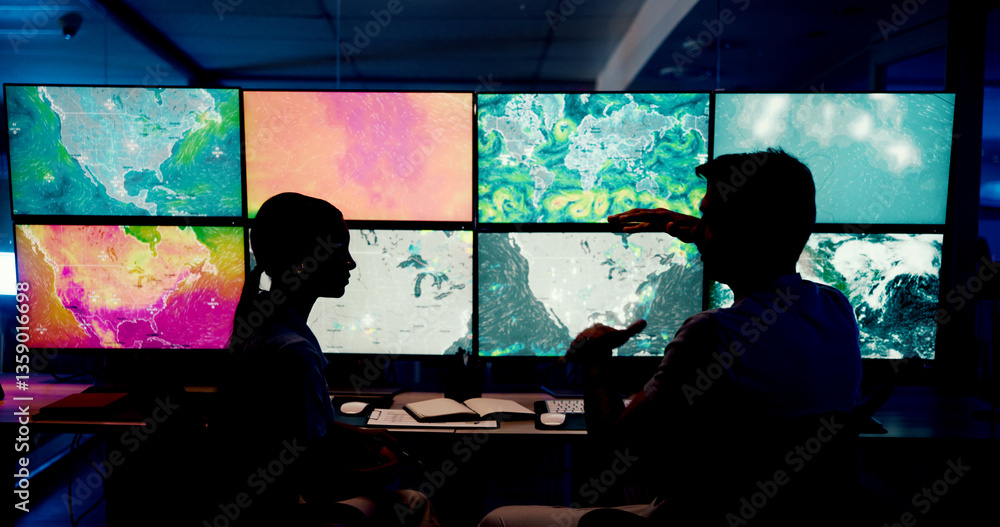

::: {.home-band .about-intro}
## About the Project

This effort began by replicating the U.S. EPA’s Climate Change Indicators, a climate communications resource originally launched in 2010. The former website is now only accessible as a snapshot, digitally preserved on January 19, 2025. This replication phase ensures continued access to the scientifically rigorous, peer‑reviewed datasets and narratives that have long supported understanding and communicating the impacts of climate change in the United States. While the site design has changed, the underlying indicators, data, narratives, and documentation remain intact and continue to adhere to established standards and methodologies for transparency, reproducibility, and data integrity.

Climate change indicators translate observed, empirical data into clear, accessible metrics that matter to people, infrastructure and natural systems. They distill complex science into information that resonates with the public and supports evidence‑based decisions. Viewed together, indicators offer a powerful, data‑driven picture: climate impacts are happening now, and they carry real consequences for communities and public health across the United States.
:::

::: {.home-band .about-collab-wrap}

::: {.about-collab}

::: {.about-collab-text}
## A Collaborative Effort

George Washington University’s [Climate and Health Institute (CHI)](https://climatehealth.gwu.edu/) is leading this effort to reconstitute the climate change indicators project, with support from a Wellcome Trust grant and the Lynn R. Goldman Professorship at the GW Milken Institute School of Public Health (GWSPH). The project is led by former EPA staff who developed and launched climate change indicators while at EPA, along with faculty from GWSPH and the GW School of Engineering and Applied Sciences. An interdisciplinary group of undergraduate, master’s and PhD students is exploring ways to revive, advance and develop the indicators, providing a valuable experiential learning opportunity.
:::

::: {.about-collab-img}
{fig-alt=""}
:::

:::

:::

::: {.home-band .about-section .ruled}
## Next Steps

We are working towards updating these indicators to reflect emerging data, and, in particular, expanding and contextualizing U.S. impact indicators to reach new audiences and applications. The next phase will leverage growing research, support the development of new climate‑health expertise, and connect students, scientists, and practitioners to ensure indicators remain robust, accessible, and relevant.

Engagement is central to this work. GW’s CHI plans to coordinate with a wide range of stakeholders and data providers to ensure indicators reflect real‑world needs and support decision‑making across communities.

See [Where We’re Heading](https://climatehealth.gwu.edu/) for a fuller discussion. 

:::

::: {.home-band .about-section}
## The Climate Data Landscape

This TrackingClimateImpacts.us project is part of a broader ecosystem of organizations dedicated to maintaining trusted, publicly accessible climate information. Two organizations, in particular, provide foundational climate data that have long supported global and national indicator efforts.

::: {.about-cards}

::: {.about-card}
### Climate.us

climate.us, the nonprofit successor to Climate.gov, offers authoritative long‑term climate data, information on climate drivers and variability, and many other resources that advance public climate literacy. It also hosts the U.S. Global Change Research Program’s Fifth National Climate Assessment, the most recent and comprehensive assessment of climate change in the United States.

[Learn More](https://www.climate.us/){.home-btn}
:::

::: {.about-card}
### GHGIA

University of Maryland’s Center for Global Sustainability (CGS) has developed a new annual non-governmental Greenhouse Gas Inventory and Analysis (GHGIA), a transparent and analytically rigorous resource that supports continued understanding of U.S. emissions and sinks. While not an official national inventory nor a submission to the United Nations Framework Convention on Climate Change, the GHGIA aligns with international best practices and builds on EPA’s long‑standing Inventory of U.S. Greenhouse Gas Emissions and Sinks.

[Learn More](https://ghgi.cgs.umd.edu/){.home-btn}
:::

:::

These and other resources are linked at Emissions & Climate Resources. Together, these efforts help ensure that the public, policymakers, researchers, and communities have access to reliable, science‑based information. Future phases of our work will focus on deepening integration across these and additional efforts. 
:::

::: {.home-band .about-find}
## What You’ll Find Here

TrackingClimateImpacts.us focuses on indicators that connect scientific observation to human and societal consequences. Climate Health and Environment provides a wide range of climate impact indicators along with detailed technical documentation for each including data sources and reproducible code. An overview of the methodology used by EPA (through January, 2025) to identify, develop and document indicators, along with EPA’s most recent Technical Documentation, can be found in Methodology. 

Indicators of global and U.S. emissions as well as changes in Earth and climatic systems are included for context. In Emissions & Climate Resources, we refer to GHGIA for data and figures pertaining to U.S. greenhouse gas emissions. Methodology and FAQs can be found at GHGIA. We refer to climate.us for many climate change drivers, variability and other global climate change data. Climate.us provides their  methodology, documentation and further discussion.  
Emissions & Climate Resources also provides easy access to additional climate change resources 

:::

::: {.home-band .about-section .about-commit}
## We are committed to:

- Maintaining a durable, open, reproducible climate impact indicator resource
- Supporting collaboration across data providers, researchers, and communities
- Ensuring indicators remain transparent, trusted, and scientifically rigorous
- Building the next generation of climate‑impact indicators through applied research and engagement
:::


