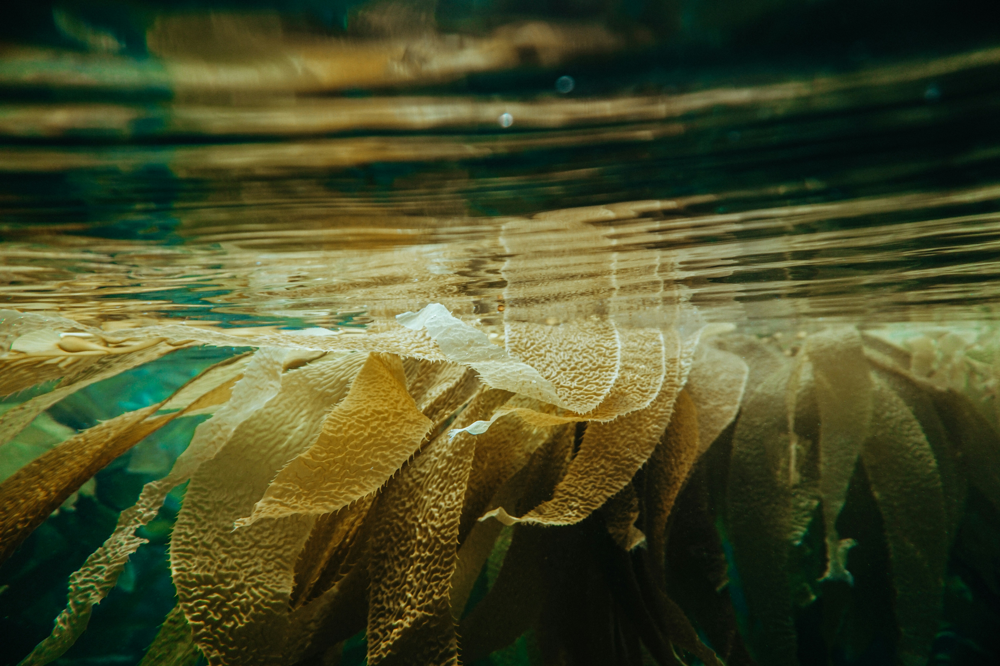

::: {.home-band .cat-hero .cat-coastal-marine .hero-bg}

::: {.hero-bg-img}
{fig-alt=""}
:::

## Coastal and Marine
:::

::: {.home-band .cat-body}
::: {.cat-intro}
This indicator tracks marine heat waves, sea levels, coastal flooding, ocean acidity, and land loss along the Atlantic coastline.
:::

::: {.cat-columns}


::: {.cat-main}
::: {#cat-listing}
:::

[View All](/health-and-environment-indicators.qmd){.cat-viewall}
:::
:::
:::


