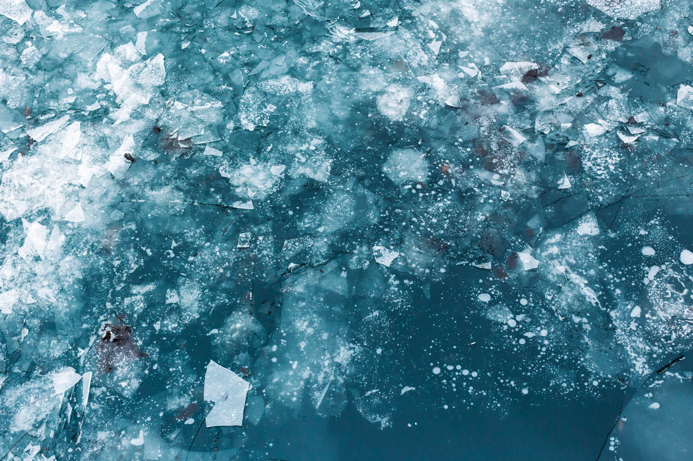

::: {.home-band .cat-hero .cat-cryosphere .hero-bg}

::: {.hero-bg-img}
{fig-alt=""}
:::

## Snow and Ice
:::

::: {.home-band .cat-body}
::: {.cat-intro}
This indicator tracks changes in lake ice, Great Lakes ice cover, snowfall, snow cover, snowpack, permafrost, freeze-thaw conditions, glaciers, and river ice breakup.
:::

::: {.cat-columns}


::: {.cat-main}
::: {#cat-listing}
:::

[View All](/health-and-environment-indicators.qmd){.cat-viewall}
:::
:::
:::


