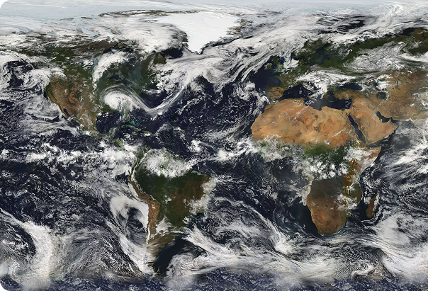
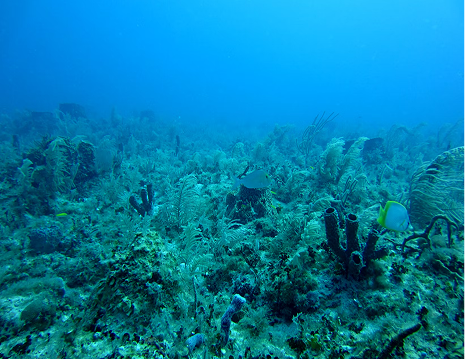
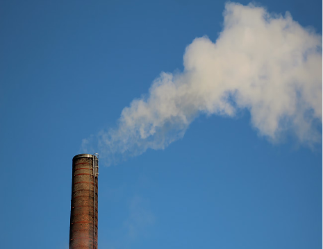
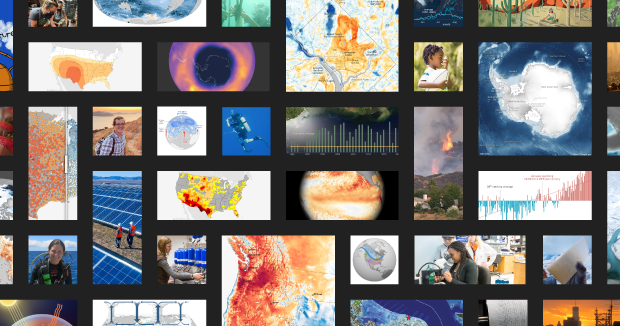
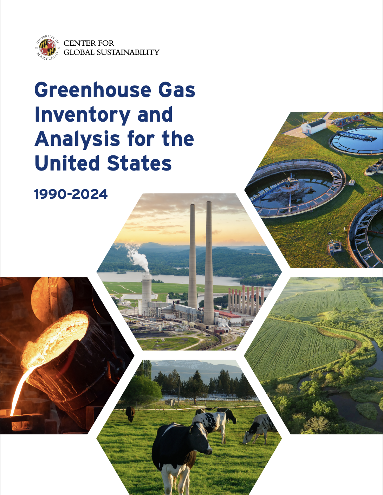

Emissions & Climate\
Resources
--------------------

## The Full Arc of Climate Change

Climate indicators illuminate the full arc of climate change—from trends in the greenhouse gas emissions that drive planetary warming, to shifts in Earth’s systems, to the impacts felt in communities and ecosystems.

While *TrackingClimateImpacts.us* provides a range of indicators and focuses on the impacts of climate change in the United States, understanding those impacts requires seeing them within the broader context of global change.

[Climate Indicators ↗](health-and-environment-indicators.llms.md)

## Emissions To Impacts

Human‑generated greenhouse gas emissions—including carbon dioxide, methane, nitrous oxide, and fluorinated gases—come from fossil fuel combustion, industrial processes, agriculture, and other human activities. These emissions increase concentrations of greenhouse gases in the atmosphere, and these higher concentrations trap heat and warm the planet. This warming drives changes across the atmosphere, oceans, and cryosphere, altering weather patterns, accelerating sea‑level rise, reshaping ocean currents, and reducing land and sea ice.

**Some greenhouse gases also have direct impacts:**

Carbon dioxide both fertilizes plants and acidifies the oceans.

Methane’s reaction in the atmosphere creates ozone which damages both human health and plant growth.

## How change shows up locally

These interconnected changes influence how climate impacts unfold regionally and locally.

*No single indicator tells the whole story—each is part of a larger system responding to human‑driven change and natural variability*

## The Climate Data Landscape

Our Climate, Health and Environment Indicators page provides U.S. trends in climate-related impacts including weather and extreme events, impacts on snow and ice, and various impacts on human health, society, and ecosystems. Several organizations also maintain trusted, publicly accessible resources that complement and set the context for the indicators found here. Together, these resources help track the full climate system and tell a more complete climate story—from emissions to drivers to impacts.

**We highlight material from two organizations:**

Climate.us

climate.us, the nonprofit successor to Climate.gov, offers authoritative long‑term climate data, information on climate drivers and variability, and many other resources that advance public climate literacy. It also hosts the U.S. Global Change Research Program’s Fifth National Climate Assessment, the most recent and comprehensive assessment of climate change in the United States.

[Learn More](https://www.climate.us/)

GHGIA

University of Maryland’s Center for Global Sustainability (CGS) has developed a new annual non-governmental Greenhouse Gas Inventory and Analysis (GHGIA), a transparent and analytically rigorous resource that supports continued understanding of U.S. emissions and sinks. While not an official national inventory nor a submission to the United Nations Framework Convention on Climate Change, the GHGIA aligns with international best practices and builds on EPA’s long‑standing Inventory of U.S. Greenhouse Gas Emissions and Sinks.

[Learn More](https://ghgi.cgs.umd.edu/)

## References

<https://nca5.climate.us/>: The U.S. Global Change Research Program’s Fifth National Climate Assessment (2023), the most recent and comprehensive assessment of climate change in the United States.\
<https://www.ipcc.ch/assessment-report/ar6/>: The IPCC Sixth Assessment Report (released 2021-2023) is the most recent IPCC assessment and is the definitive assessment for global climate science.\
<https://www.nationalacademies.org/read/25733>: The US National Academy of Sciences and the UK Royal Society teamed up to produce a primer on climate science.\
<https://www.nationalacademies.org/read/29239/chapter/1>: US National Academy of Sciences, Engineering, and Medicine published Effects of Human-Caused Greenhouse Gas Emissions on U.S. Climate, Health, and Welfare (2025).

**GW Climate and Health Institute**

950 New Hampshire Ave, NW, 101 — First Floor\
Washington, DC 20052

### About

- [About](about.llms.md)
- [Where We’re Heading](where-were-heading.llms.md)

### Emissions & Climate Resources

- [Emissions & Climate Resources](emissions-and-climate-resources.llms.md)
- [Green House Gases](greenhouse-gases.llms.md)
- [Global Climate Indicators](global-climate-indicators.llms.md)
- [Additional Resources](additional-resources.llms.md)

### The Indicators

- [Weather and Extreme Events](indicators/weather-and-extreme-events/index.llms.md)
- [Snow and Ice](indicators/snow-and-ice/index.llms.md)
- [Coastal and Marine](indicators/coastal-and-marine/index.llms.md)
- [Freshwater Systems](indicators/freshwater-systems/index.llms.md)
- [Ecosystems](indicators/ecosystems/index.llms.md)
- [Temperature-Related Health](indicators/temperature-related-health/index.llms.md)
- [Vector-Related Health](indicators/vector-related-health/index.llms.md)
- [Societal Systems](indicators/societal-systems/index.llms.md)

### GW

- [Campus Advisories](https://campusadvisories.gwu.edu/)
- [EO/Nondiscrimination Policy](https://compliance.gwu.edu/equal-opportunity-nondiscrimination-anti-harassment-and-non-retaliation)
- [Website Privacy Notice](https://www.gwu.edu/privacy-notice)
- [Contact GW](https://www.gwu.edu/contact-gw)
- [Accessibility](https://accessibility.gwu.edu/)
- [Terms of Use](https://www.gwu.edu/terms-use)
- [Copyright](https://www.gwu.edu/copyright)
- [Report a Barrier to Accessibility](https://accessibility.gwu.edu/report-barrier-accessibility)

- Terms of Service
- Privacy Policy
- Contact Us

Back to top
