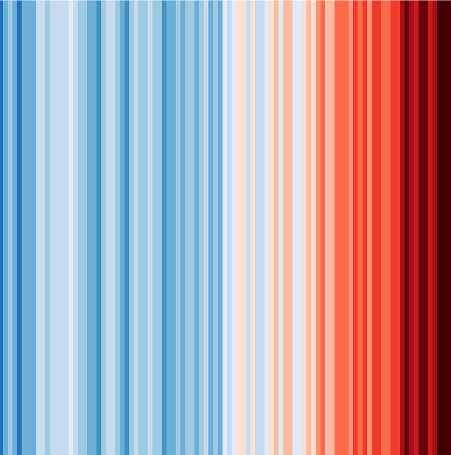
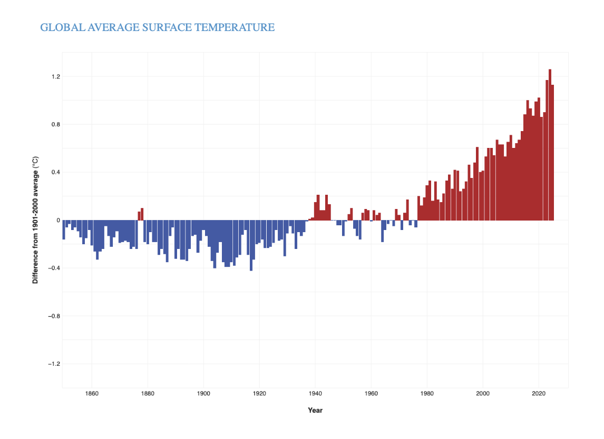
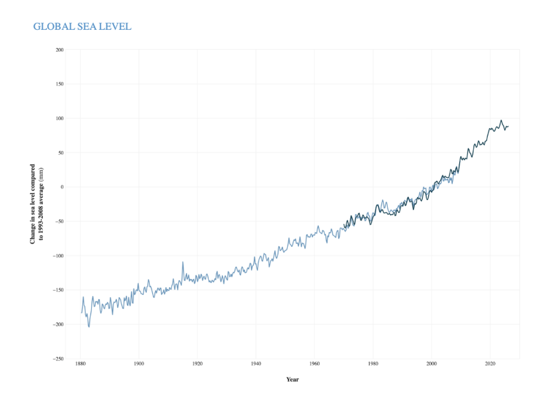
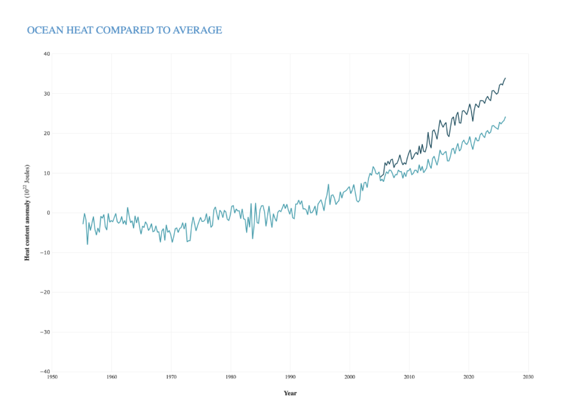
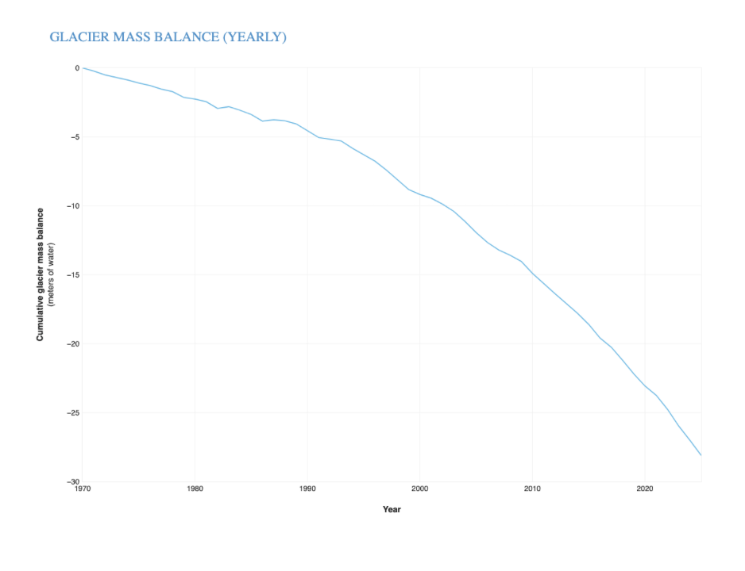
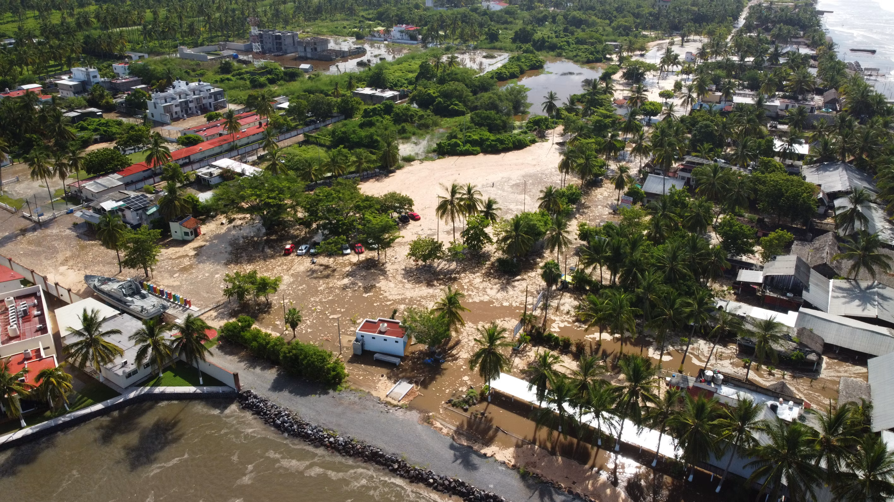

## Global Climate Indicators

Multiple metrics provide clear signals of global change in temperature, sea level, ice sheets, ocean heat, and more. Several key indicators are highlighted here. Extensive documentation and discussion regarding drivers of climate change, earth systems, attribution, and variability can also be found in the climate assessment literature linked at [Additional Climate Change Resources](additional-resources.llms.md).

A more complete set of indicators and narratives focused on climate drivers and variability can be found at [climate.us](https://www.climate.us/). We provide several examples from climate.us (CC BY-SA 4.0 Attribution-ShareAlike 4.0 International).

## Global surface temperature

Temperature is a fundamental measurement for describing the climate, and the temperature in particular places can have wide-ranging effects on human life and ecosystems. For example, increases in air temperature can lead to more intense heat waves, which can cause illness and death, especially in vulnerable populations. Annual and seasonal temperature patterns also determine the types of animals and plants that can survive in particular locations. Changes in temperature can disrupt a wide range of natural processes, particularly if these changes occur more quickly than plant and animal species can adapt.

Concentrations of heat-trapping greenhouse gases are increasing in the Earth’s atmosphere. In response, average temperatures at the Earth’s surface are increasing and are expected to continue rising.¹ Because climate change can shift the wind patterns and ocean currents that drive the world’s climate system, some areas are warming more than others, and some have experienced cooling.

Excerpted from U.S. Environmental Protection Agency. (2024). Climate change indicators in the United States (Fifth ed., EPA 430-R-24-003).

This figure shows yearly surface temperature from 1880 - 2024 compared to the 20th-century average. Blue bars indicate cooler-than-average years; red bars show warmer-than-average years. The Climate.us figure is based on data from the National Centers for Environmental Information.

Given the tremendous size and heat capacity of the global oceans, it takes a massive amount of added heat energy to raise Earth’s average surface temperature even a small amount. The roughly 2-degree-Fahrenheit (1-degree-Celsius) increase in global average surface temperature that has occurred since the pre-industrial era (1850-1900 in NOAA’s record) might seem small, but it represents a significant increase in heat energy circulating through all parts of the Earth system, including the oceans, frozen landscapes, and the atmosphere.

Earth’s temperature has risen by an average of 0.11° Fahrenheit (0.06° Celsius) per decade since 1850, or about 2° F in total. The rate of warming since the early 1980s is more than three times as fast: 0.38° F (0.21° C) per decade. 2025 was the third-warmest year since global records began in 1850 according to NOAA’s record. The 10 warmest years in the 176-year record have all occurred since 2015. (climate.us)

## Global Sea Level

As the temperature of the Earth changes, so does sea level. Temperature and sea level are linked for two main reasons. First, changes in the volume of water and ice on land (namely glaciers and ice sheets) can increase or decrease the volume of water in the ocean. Second, as water warms, it expands slightly—an effect that is cumulative over the entire depth of the oceans.

Changing sea level can affect human activities in coastal areas. Rising sea level inundates low-lying wetlands and dry land, erodes shorelines, contributes to coastal flooding, and increases the flow of salt water into estuaries and nearby groundwater aquifers. Higher sea level also makes coastal infrastructure more vulnerable to damage from storms.

The sea level changes that affect coastal systems involve more than expanding oceans, however, because the Earth’s continents can also rise and fall relative to the oceans. Land can rise through processes such as sediment accumulation (the process that built the Mississippi River delta) and geological uplift (for example, as glaciers melt and the land below is no longer weighed down by heavy ice). In other areas, land can sink because of erosion, sediment compaction, natural subsidence (sinking due to geologic changes), groundwater withdrawal, or engineering projects that prevent rivers from naturally depositing sediments along their banks. Changes in ocean currents such as the Gulf Stream can also affect sea level by pushing more water against some coastlines and pulling it away from others, raising or lowering sea levels accordingly.

Excerpted from U.S. Environmental Protection Agency. (2024). Climate change indicators in the United States (Fifth ed., EPA 430-R-24-003).

As Earth’s temperatures rise, so does sea level. Water lost from melting glaciers and ice sheets ends up in the oceans, directly contributing to rising sea level. Warmer ocean temperatures also cause the water itself to expand. The climate.us figures below show long-term trends in Global Sea Level, Ocean Heat and Glacier Mass Balance.

Global average sea level has risen at least 8–9 inches (21–24 centimeters) since 1880. In 2024, global average sea level set a new record high—105.8 mm (4.17 inches) above the 1993 average. The rate of global sea level rise is accelerating. The average yearly increase from 2006-2015 (0.14 inches, or 3.6 millimeters, per year) was more than twice as fast as the average over most of the twentieth century (0.06 inches, or 1.4 millimeters, per year).

The ocean is storing an estimated 9/10 of the excess heat energy trapped in the Earth’s climate system by excess greenhouse gases. Increasing ocean heat content is contributing to sea level rise, ocean heat waves and coral bleaching, heavier rain events, and melting of ocean-terminating glaciers and ice sheets around Greenland and Antarctica.

Worldwide, most glaciers are shrinking or disappearing altogether. The “climate reference glaciers” tracked by the World Glacier Monitoring Service have lost ice mass equivalent to more than 30 meters of liquid water through 2025—the same as slicing roughly 33 meters (108 feet) of ice off the entire surface of each glacier in the network. Glaciers have shrunk every year for the past 39 years. Ice loss in mountain glaciers is accelerating with each of the last three complete decades has brought bigger declines than the decade before. Melting glaciers and ice sheets are the biggest cause of sea level rise in recent decades. (climate.us)

Seasonal (3-month) sea level estimates (Church and White, 2011) - light blue line, and University of Hawaii Fast Delivery sea level data - dark blue. The values are shown as change in sea level in millimeters compared to the 1993-2008 average. Climate.us image based on analysis and data from Philip Thompson, University of Hawaii Sea Level Center

Seasonal heat content compared to the 1955-2006 average for the upper 700 meters of the ocean (light blue-green) and in the upper 2000 meters (dark blue-green). Heat content in the global ocean has been above-average since the mid-1990s. Graph by Climate.us, based on data from NOAA NCEI.

Ice loss relative to 1970 for the glaciers in the World Glacier Monitoring Service’s (WGMS) climate reference network. Glacier mass balance is the annual balance between how much snow accumulates on a glacier and how much ice is lost through melting, sublimation (evaporation), or iceberg calving. Through 2025, these glaciers have lost more than 28 meters of water equivalent, which is roughly the same as slicing a 100-foot slab off the top of each glacier in the network. Climate.us image, based on data from the WGMS.

### Information regarding Global Sea Level Rise can be found here:

Sea Level

This indicator describes how sea level has changed over time.

[Explore →](indicators/sea-level.llms.md)

References

¹ Marvel, K., Su, W., Delgado, R., Aarons, S., Chatterjee, A., Garcia, M. E., Hausfather, Z., Hayhoe, K., Hence, D. A., Jewett, E. B., Robel, A., Singh, D., Tripati, A., & Vose, R. S. (2023). Chapter 2: Climate trends. In USGCRP (U.S. Global Change Research Program), Fifth National Climate Assessment. <https://doi.org/10.7930/NCA5.2023.CH2>

**GW Climate and Health Institute**

950 New Hampshire Ave, NW, 101 — First Floor\
Washington, DC 20052

### About

- [About](about.llms.md)
- [Where We’re Heading](where-were-heading.llms.md)

### Emissions & Climate Resources

- [Emissions & Climate Resources](emissions-and-climate-resources.llms.md)
- [Greenhouse Gases](greenhouse-gases.llms.md)
- [Global Climate Indicators](global-climate-indicators.llms.md)
- [Additional Resources](additional-resources.llms.md)

### The Indicators

- [Weather and Extreme Events](indicators/weather-and-extreme-events/index.llms.md)
- [Snow and Ice](indicators/snow-and-ice/index.llms.md)
- [Coastal and Marine](indicators/coastal-and-marine/index.llms.md)
- [Freshwater Systems](indicators/freshwater-systems/index.llms.md)
- [Ecosystems](indicators/ecosystems/index.llms.md)
- [Temperature-Related Health](indicators/temperature-related-health/index.llms.md)
- [Vector-Related Health](indicators/vector-related-health/index.llms.md)
- [Societal Systems](indicators/societal-systems/index.llms.md)

### GW

- [Campus Advisories](https://campusadvisories.gwu.edu/)
- [EO/Nondiscrimination Policy](https://compliance.gwu.edu/equal-opportunity-nondiscrimination-anti-harassment-and-non-retaliation)
- [Website Privacy Notice](https://www.gwu.edu/privacy-notice)
- [Contact GW](https://www.gwu.edu/contact-gw)
- [Accessibility](https://accessibility.gwu.edu/)
- [Terms of Use](https://www.gwu.edu/terms-use)
- [Copyright](https://www.gwu.edu/copyright)
- [Report a Barrier to Accessibility](https://accessibility.gwu.edu/report-barrier-accessibility)

- Terms of Service
- Privacy Policy
- [Contact Us](mailto:climatehealth@gwu.edu)

Back to top
