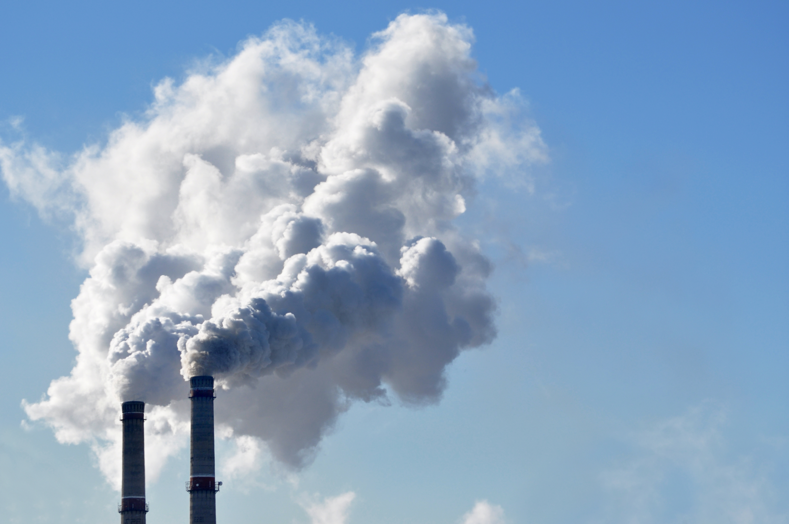
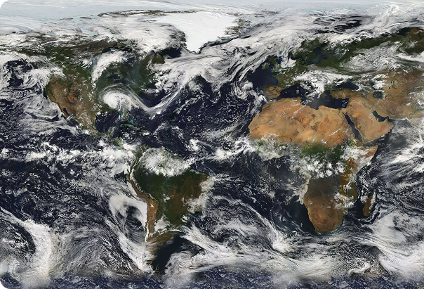
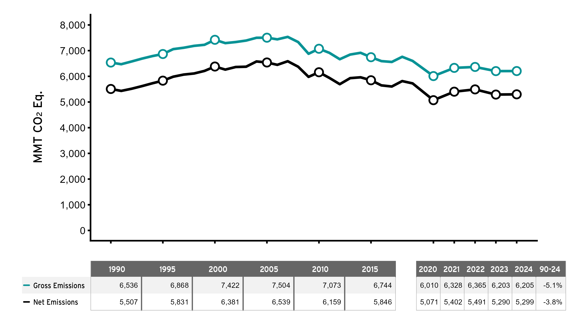
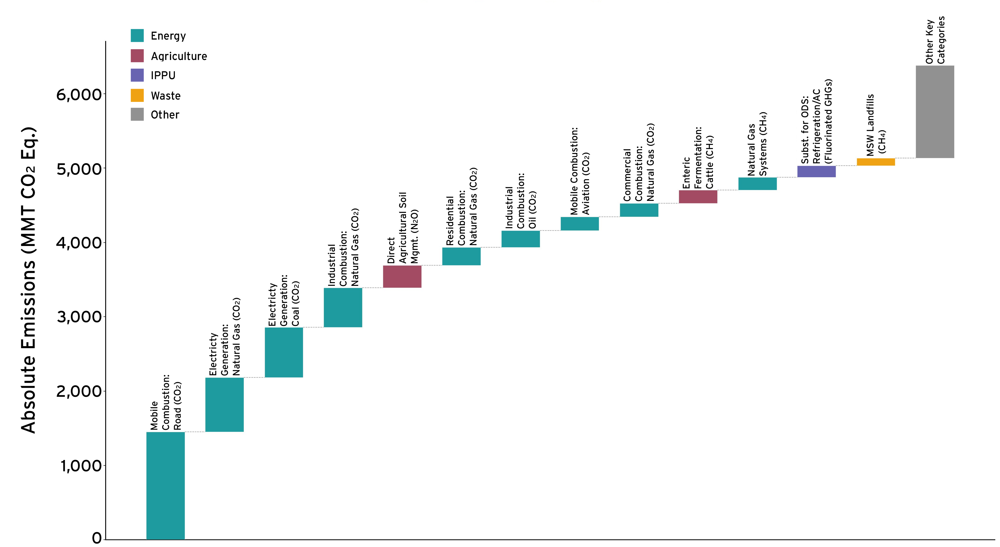
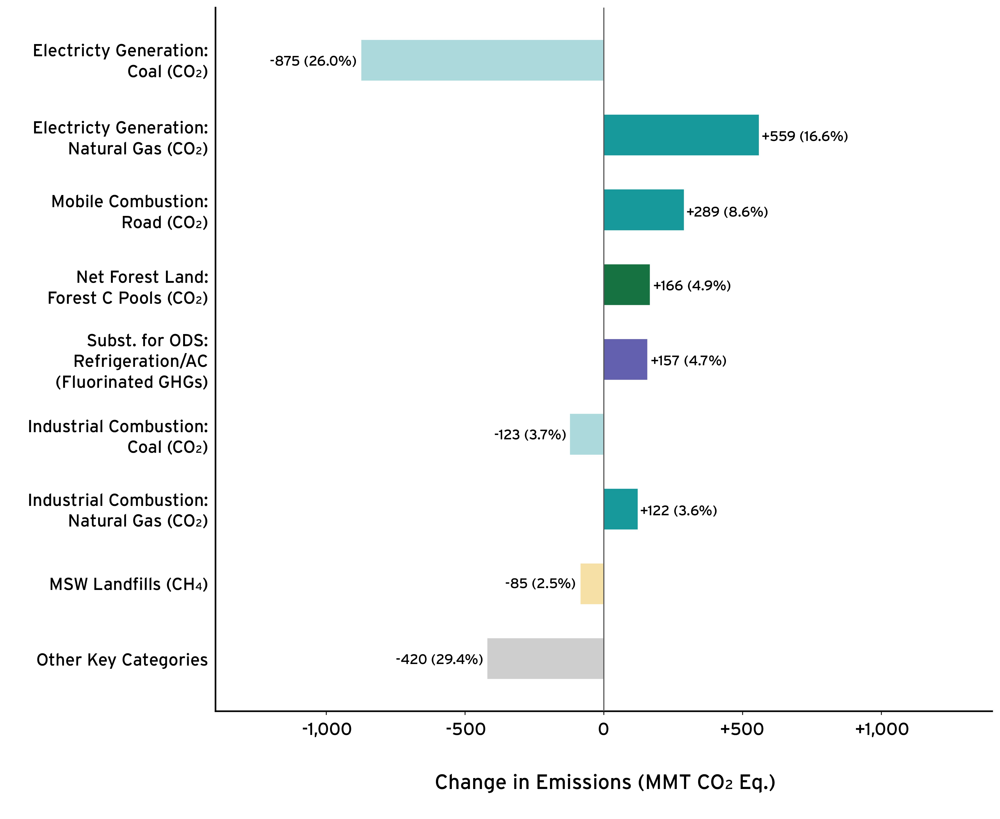
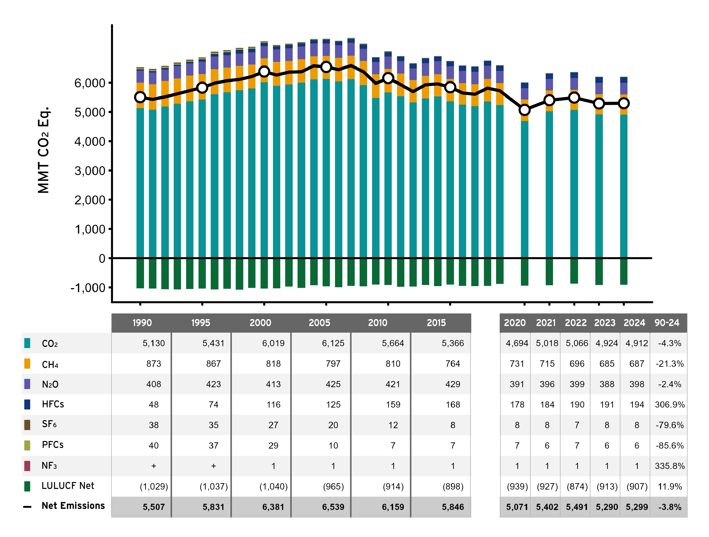
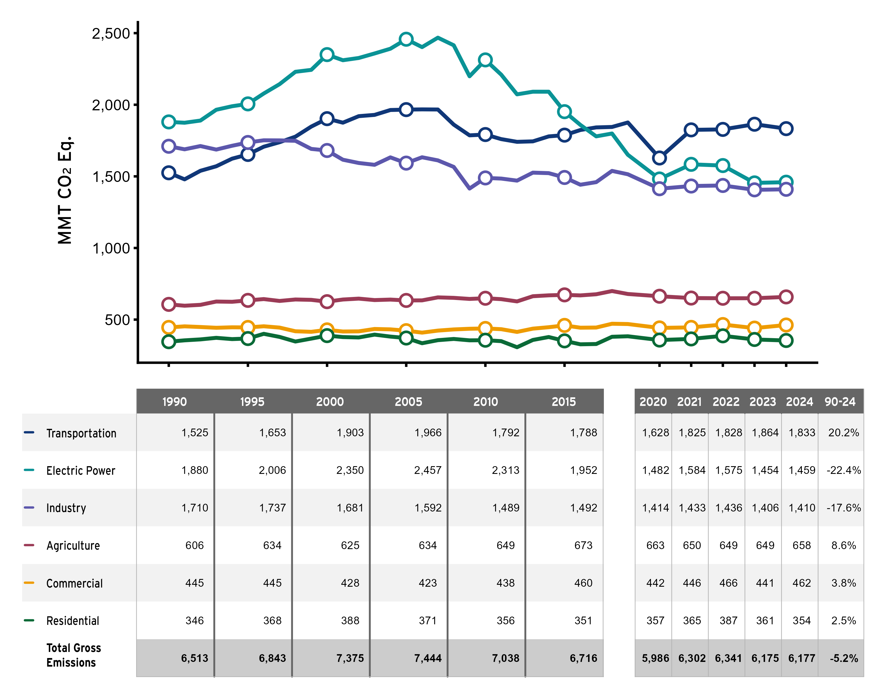
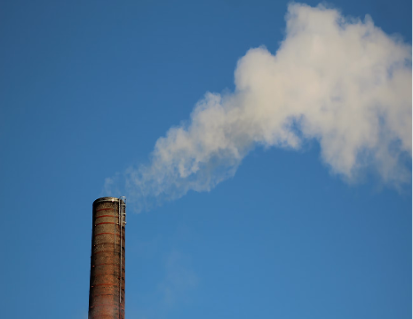
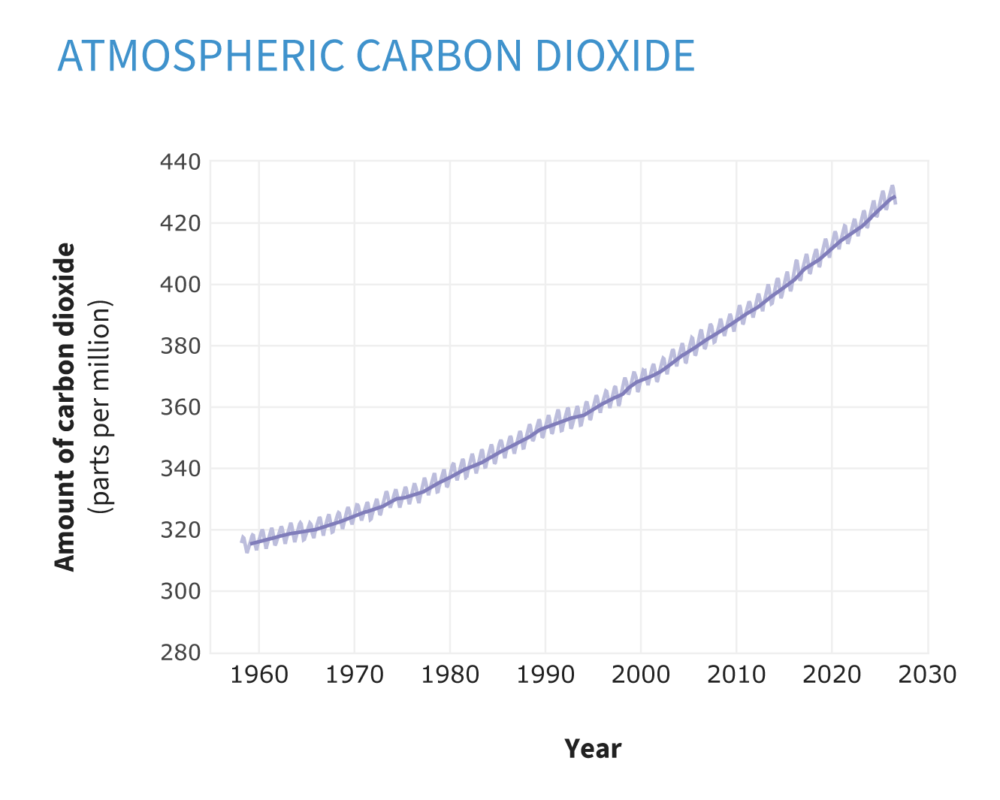
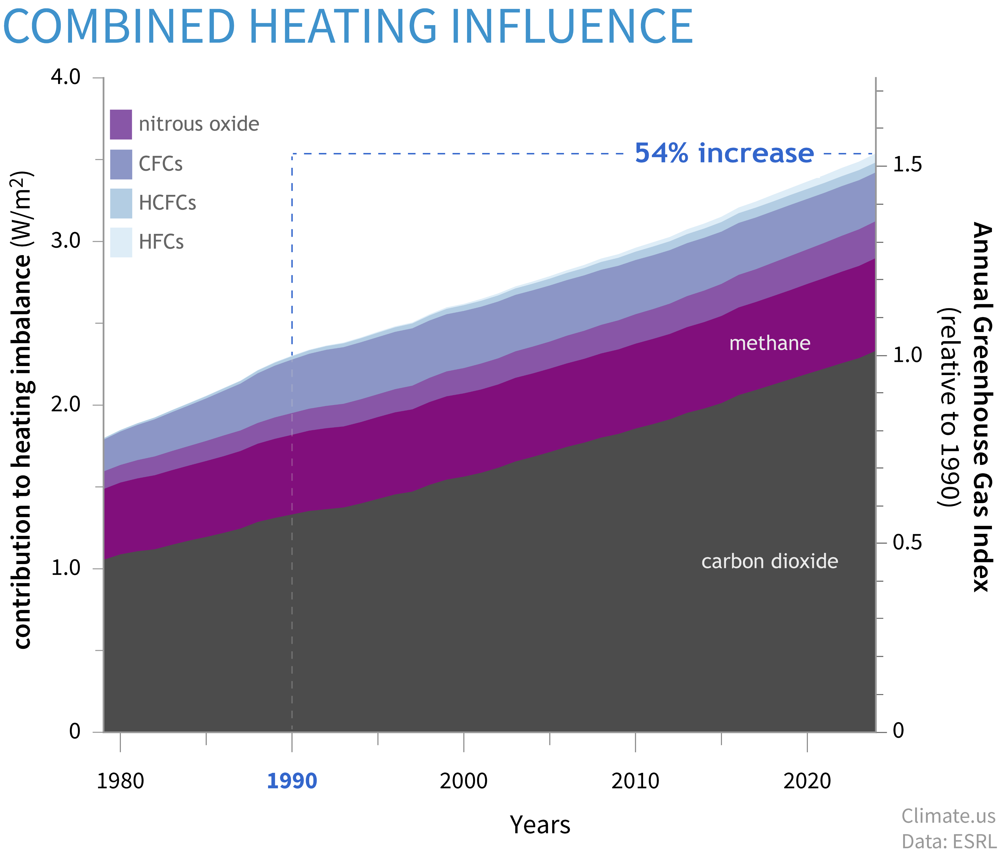

::: {.home-band .ghg-hero .hero-split}

::: {.hero-split-text}
## Greenhouse Gases

Greenhouse gases from human activities are the most significant driver of observed climate change since the mid-20th century.1 When comparing emissions of different gases, these indicators use a concept called “global warming potential” to convert amounts of other gases into carbon dioxide equivalents.
:::

::: {.hero-split-img}
{fig-alt=""}
:::

:::

::: {.home-band .ghg-why-wrap}
::: {.ghg-why}
## Why does it matter?

As greenhouse gas emissions from human activities increase, they build up in the atmosphere and warm the climate, leading to many other changes around the world—in the atmosphere, on land, and in the oceans. The indicators in other sections of this website illustrate many of these changes, which have both positive and negative effects on people, society, and the environment—including plants and animals. Because many of the major greenhouse gases stay in the atmosphere for tens to hundreds of years after being released, their warming effects on the climate persist over a long time and can therefore affect both present and future generations.

::: {.ghg-why-img}
{fig-alt="Satellite view of Earth's clouds and continents"}
:::
:::
:::

::: {.home-band .ghg-topics}
::: {.ghg-topic}
[U.S. Greenhouse Gas Emissions]{.ghg-topic-title}\
In the United States, carbon dioxide accounts for most of the nation’s emissions. Transportation is the largest source of 2022 greenhouse gas emissions in the United States, followed by electricity generation.
:::

::: {.ghg-topic}
[Global Greenhouse Gas Emissions]{.ghg-topic-title}\
Worldwide, emissions of carbon dioxide account for about three-fourths of total emissions. As with the United States, the majority of the world’s emissions result from transportation, electricity generation, and other forms of energy production and use.
:::

::: {.ghg-topic}
[Atmospheric Concentrations of Greenhouse Gases]{.ghg-topic-title}\
Concentrations of carbon dioxide and other greenhouse gases in the atmosphere have increased since the beginning of the industrial era. Almost all of this increase is attributable to human activities.2 Historical measurements show that the current global atmospheric concentrations of carbon dioxide are unprecedented compared with the past 800,000 years, even after accounting for natural fluctuations.
:::

::: {.ghg-topic}
[Climate Forcing]{.ghg-topic-title}\
Climate forcing refers to a change in the Earth’s energy balance, leading to either a warming or cooling effect over time. An increase in the atmospheric concentrations of greenhouse gases produces a positive climate forcing, or warming effect. From 1990 to 2023, the total warming effect from greenhouse gases added by humans to the Earth’s atmosphere increased by 54 percent. Carbon dioxide alone is responsible for about 80 percent of the increase.
:::
:::

::: {.home-band .ghg-gases}
## Major Greenhouse Gases Associated with Human Activities

<table class="ghg-table">
<thead>
<tr><th>Greenhouse gas</th><th>How it's produced</th><th>Average lifetime in the atmosphere</th><th>100-year global warming potential</th></tr>
</thead>
<tbody>
<tr><th scope="row">Carbon dioxide</th><td>Emitted primarily through the burning of fossil fuels (oil, natural gas, and coal), solid waste, and trees and wood products. Changes in land use also play a role. Deforestation and soil degradation add carbon dioxide to the atmosphere, while forest regrowth takes it out of the atmosphere.</td><td>see below*</td><td><strong>1</strong></td></tr>
<tr><th scope="row">Methane</th><td>Emitted during the production and transport of oil and natural gas as well as coal. Methane emissions also result from livestock and agricultural practices and from the anaerobic decay of organic waste in municipal solid waste landfills.</td><td>11.8 years</td><td><strong>27.0–29.8**</strong></td></tr>
<tr><th scope="row">Nitrous oxide</th><td>Emitted during agricultural and industrial activities, as well as during combustion of fossil fuels and solid waste.</td><td>109 years</td><td><strong>273</strong></td></tr>
<tr><th scope="row">Fluorinated gases</th><td>A group of gases that contain fluorine, including hydrofluorocarbons, perfluorocarbons, and sulfur hexafluoride, among other chemicals. These gases are emitted from a variety of industrial processes and commercial and household uses and do not occur naturally. Sometimes used as substitutes for ozone-depleting substances such as chlorofluorocarbons.</td><td>A few weeks to thousands of years</td><td><strong>Varies</strong> (the highest is sulfur hexafluoride at 25,200)</td></tr>
</tbody>
</table>

::: {.ghg-table-notes}
This table shows 100-year global warming potentials, which describe the effects that occur over a period of 100 years after a particular mass of a gas is emitted. Global warming potentials and lifetimes come from Tables 7.15 and 7.SM.7 of the Intergovernmental Panel on Climate Change’s Sixth Assessment Report, Working Group I contribution.3

\* Carbon dioxide’s lifetime cannot be represented with a single value because the gas is not destroyed over time, but instead moves among different parts of the ocean–atmosphere–land system. Some of the excess carbon dioxide is absorbed quickly (for example, by the ocean surface), but some will remain in the atmosphere for thousands of years, due in part to the very slow process by which carbon is transferred to ocean sediments.

\*\* Methane's global warming potential is shown as a range that includes methane from both fossil and non-fossil sources.

Excerpted from U.S. Environmental Protection Agency. (2024). Climate change indicators in the United States (Fifth ed., EPA 430-R-24-003).
:::
:::

::: {.home-band .ghg-refs-wrap}
::: {.ghg-refs}
[References]{.ghg-refs-title}

1 IPCC (Intergovernmental Panel on Climate Change). 2021. Climate change 2021: The physical science basis. Working Group I contribution to the IPCC Sixth Assessment Report. Cambridge, United Kingdom: Cambridge University Press. [www.ipcc.ch/assessment-report/ar6](https://www.ipcc.ch/assessment-report/ar6/).\
2 IPCC (Intergovernmental Panel on Climate Change). 2021. Climate change 2021: The physical science basis. Working Group I contribution to the IPCC Sixth Assessment Report. Cambridge, United Kingdom: Cambridge University Press. [www.ipcc.ch/assessment-report/ar6](https://www.ipcc.ch/assessment-report/ar6/).\
3 IPCC (Intergovernmental Panel on Climate Change). 2021. Climate change 2021: The physical science basis. Working Group I contribution to the IPCC Sixth Assessment Report. Cambridge, United Kingdom: Cambridge University Press. [www.ipcc.ch/assessment-report/ar6](https://www.ipcc.ch/assessment-report/ar6/).
:::
:::

::: {.home-band .ghg-us}
## U.S. Greenhouse Gas Emissions

The University of Maryland’s Center for Global Sustainability provides comprehensive information regarding greenhouse gas emissions and sinks in the United States, including quantities of specific gases being emitted and from what economic sectors. While not an official national inventory, the GHGIA provides the *Greenhouse Gas Inventory and Analysis for the United States, 1990-2024., Also available: Methodology Report for Greenhouse Gas Inventory and Analysis by U.S. State, 1990-2024*, and an accompanying State Inventory Tool.

**Here, we provide several examples from the GHGIA.**
:::

::: {.home-band .ghg-section}
## Summary of Trends

The figure below shows the trend in both gross and net U.S. GHG emissions and removals since 1990. In 2024, total gross emissions were 6,205.3 million metric tons of carbon dioxide equivalent (MMT CO~2~ Eq.). This total is a 5.1 percent decrease from 1990 and a 0.04 percent annual increase from 2023. The decreasing trend from around 2005 is associated primarily with a decrease in CO~2~ emissions from fossil fuel combustion. The factors influencing this change, including declining emissions from electricity production, are discussed in more detail in Chapter 2 (Trends) and in Chapter 3 (Energy). In 2024, total net U.S. GHG emissions, including emissions and sinks from LULUCF, were 5,298.8 MMT CO~2~ Eq. This total is a 3.8 percent decrease from 1990 and a 0.2 percent annual increase from 2023. Sequestration of CO~2~ in the LULUCF sector offset the equivalent of 14.6 percent of total gross emissions in 2024 (906.5 MMT CO~2~ Eq.). Figure ES-1: U.S. Gross and Net Emissions

[U.S. Gross and Net Emissions]{.ghg-figure-title}

{.ghg-figure-img fig-alt="Trend in gross and net U.S. greenhouse gas emissions and removals since 1990"}
:::

::: {.home-band .ghg-section}
## Source and Sink Categories

The figure on the left indicates the largest categories that contributed to overall GHG emissions in 2024. The figure on the right shows categories that have experienced significant changes since 1990. Together, these categories are a subset of the inventory formally defined as “key categories” by the IPCC because they have the most significant impact on overall results.

::: {.ghg-figure-pair}
::: {}
[Key Categories for 2024 and Their Emissions (Gross)]{.ghg-figure-title}

{.ghg-figure-img fig-alt="Largest source categories of U.S. gross greenhouse gas emissions in 2024"}
:::

::: {}
[Key Categories with the Largest Changes Since 1990]{.ghg-figure-title}

{.ghg-figure-img fig-alt="Key categories with the largest changes in U.S. emissions since 1990"}
:::
:::
:::

::: {.home-band .ghg-section}
## Emissions and Removals by Gas

This figure shows the trend in emissions and removals since 1990 by greenhouse gas. CO~2~ makes up the largest share of emissions in each year, and the 4.3 percent decline since 1990 is also the largest contributor to the overall reduction in emissions. On a percentage basis, CH~4~, PFCs, and SF~6~ also declined significantly since 1990, while HFCs experienced the largest growth, N~2~O emissions did not change significantly in aggregate, but category level changes (e.g. in mobile combustion) are discussed in the GHGIA report.

[Trends in Greenhouse Gas Emissions and Sinks by Gas]{.ghg-figure-title}

{.ghg-figure-img fig-alt="Trends in U.S. greenhouse gas emissions and sinks by gas since 1990"}
:::

::: {.home-band .ghg-section}
## Emissions by Economic Sector

This figure presents GHG emissions categorized by commonly used economic sectors. It shows how economic activities consume fossil fuels for energy, which is by far the largest category of emissions. The figure depicts the relative contribution of these sectors and their emission changes over time. Electric power was the largest economic sector in 1990 but was overtaken by transportation in 2017.

[Trends by Economic Sector]{.ghg-figure-title}

{.ghg-figure-img fig-alt="Trends in U.S. greenhouse gas emissions by economic sector"}
:::

::: {.home-band .ghg-section}
### Information regarding Global Greenhouse Gas Emissions can be found here:

::: {.ghg-link-card .has-img}

::: {.ghg-link-card-text}
[Global GHG emissions]{.ghg-link-card-title}

Additional information and clarification pertaining to the historical global GHG emissions data sources used, their differences as well as key advantages and disadvantages can be found here: [Frequently Asked Questions | Climate Watch](https://www.climatewatchdata.org/about/faq/ghg).

[Explore →](indicators/global-greenhouse-gas-emissions.qmd){.ghg-link-card-cta}
:::

::: {.ghg-link-card-img}
{fig-alt="Smokestack releasing a plume of smoke into a blue sky"}
:::

:::
:::

::: {.home-band .ghg-section}
## Atmospheric Concentration of Greenhouse Gasses

### Carbon Dioxide

Each year, human activities release more carbon dioxide into the atmosphere than natural processes can remove, raising atmospheric carbon dioxide levels. The global average carbon dioxide set a new record high in 2025: 425.62 parts per million ("ppm" for short). The increase over 2024 amounts was 2.83 ppm, which makes it the third-largest one-year increase on record. Atmospheric carbon dioxide is now 50 percent higher than it was before the Industrial Revolution. The annual rate of increase in atmospheric carbon dioxide over the past 60 years is about 100 times faster than previous natural increases, such as those that occurred at the end of the last ice age 11,000-17,000 years ago. (climate.us)

{.ghg-figure-img fig-alt="Monthly average carbon dioxide at Mauna Loa Observatory since 1958"}

[Monthly average carbon dioxide at Mauna Loa Observatory since 1958 in parts per million (ppm). The seasonal cycle of highs and lows (small peaks and valleys) is driven by the Northern Hemisphere growing season. The long-term trend of rising carbon dioxide levels is driven by human activities. At Mauna Loa, the highest monthly value each year occurs in May. In May 2026, carbon dioxide hit 432.34 ppm, a new record. Climate.us image, based on Mauna Loa monthly mean data from NOAA Global Monitoring Lab. ([Climate.us](https://www.climate.us/) image, used under a [CC license](https://creativecommons.org/licenses/by-sa/4.0/deed.en).)]{.ghg-figure-title}
:::

::: {.home-band .ghg-section}
### Additional information regarding Atmospheric Concentrations of Greenhouse Gases

::: {.ghg-link-card}

::: {.ghg-link-card-text}
[Atmospheric Concentrations of Greenhouse Gases]{.ghg-link-card-title}

This indicator describes how the levels of major greenhouse gases in the atmosphere have changed over time.

[Explore →](indicators/atmospheric-concentrations.qmd){.ghg-link-card-cta}
:::

:::
:::

::: {.home-band .ghg-section}
## Heating Influence

Unlike oxygen and nitrogen, the most abundant gases in the atmosphere which are transparent to outgoing heat, greenhouse gases absorb heat energy and radiate it back into their surroundings, including back toward Earth’s surface. Without them, Earth's average surface temperature would be below freezing instead of around 60 degrees Fahrenheit. Since the onset of the Industrial Revolution, human activities have been adding heat-trapping gases to the atmosphere. By adding extra greenhouse gases, we are amplifying the natural greenhouse effect and causing Earth's surface temperature to rise.

How much are human-produced greenhouse gases influencing today’s climate? NOAA’s Annual Greenhouse Gas Index ("AGGI") estimates the direct warming influence of human-produced greenhouse gases has risen 54 percent since 1990. Most of the warming influence (66 percent) is due to carbon dioxide. Methane is the second-largest contributor (16 percent). The third-largest contributor is the chlorofluorocarbons (CFCs) category (8.4 percent). (Although CFCs are now controlled, because they are extremely long-lived in the atmosphere, they continue to play a role in Earth's heating imbalance.) climate.us

{.ghg-figure-img fig-alt="Heating influence of major human-produced greenhouse gases since 1750"}

[This graph shows the heating influence caused by the major human-produced greenhouse gases: carbon dioxide (gray), methane (dark purple), nitrous oxide (medium purple), chlorofluorocarbons (CFCs, lavender), hydrochlorofluorocarbons (HCFCs, blue), and hydrofluorocarbons (HFCs, light blue). Relative to conditions in 1750, today's atmosphere absorbs 3.54 extra Watts of energy per square meter of Earth's surface The colored shapes in this graph show how much each greenhouse gas contributes to the total heating imbalance in Earth’s atmosphere.]{.ghg-figure-title}
:::


