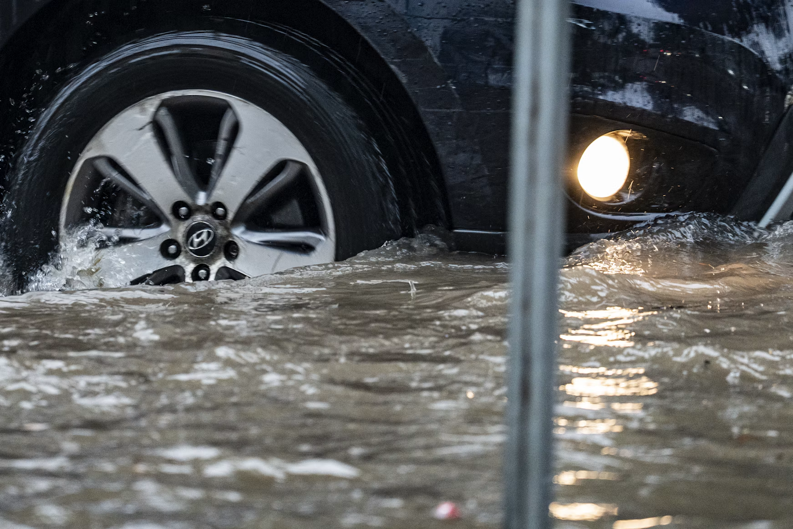
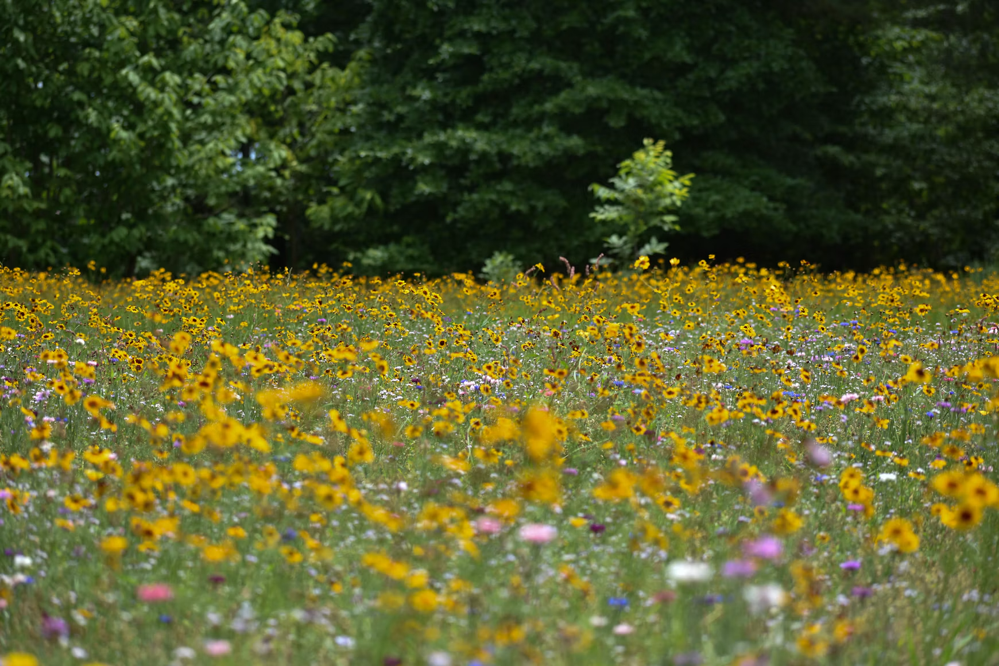
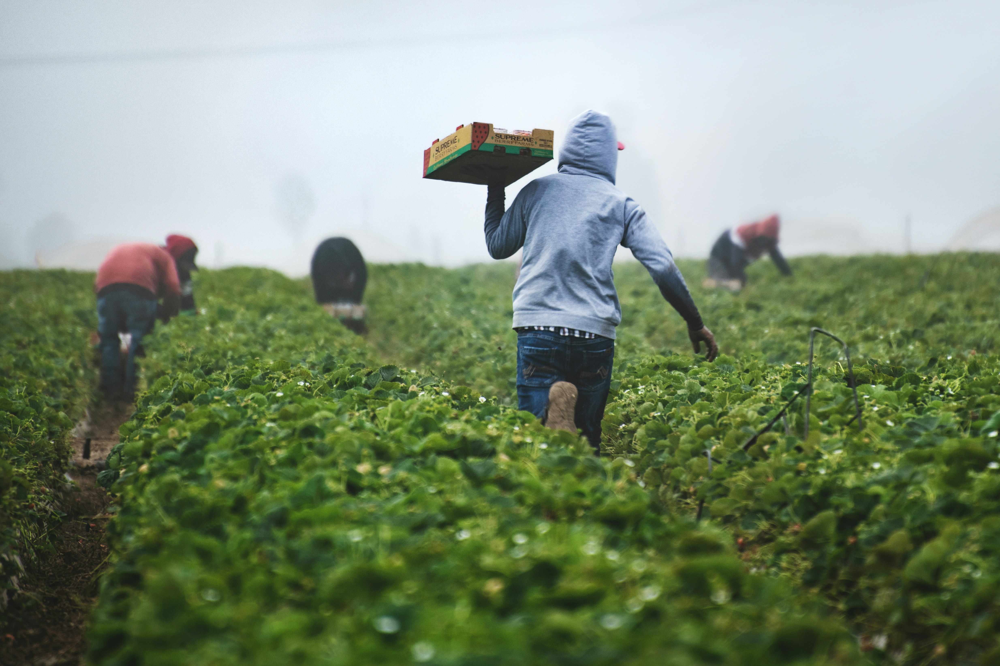
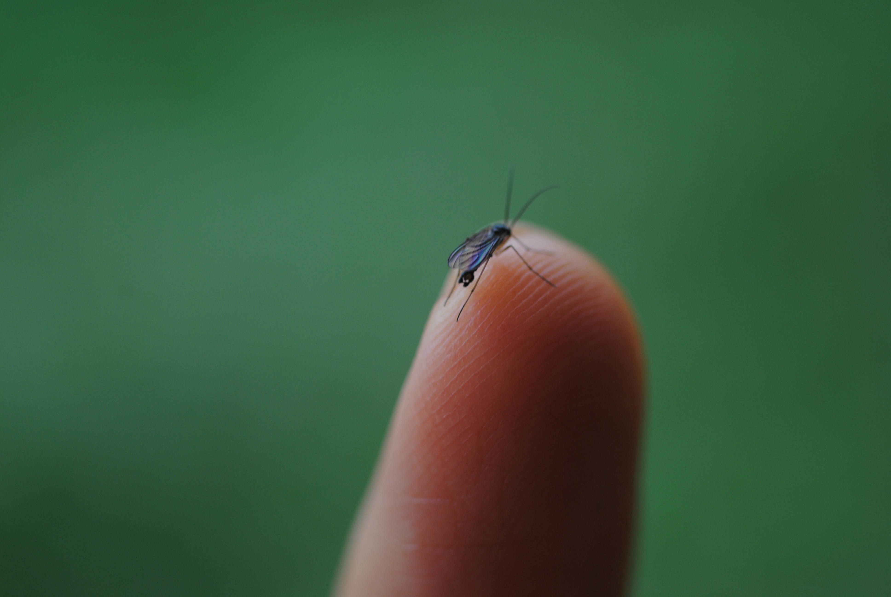
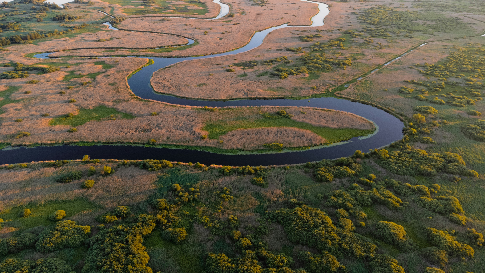

::: {.home-band .che-hero}

::: {.che-hero-text}
## Climate, Health and Environment Indicators

Rising temperatures, shifting snow and rainfall patterns, and more frequent extreme weather events are clear signs of a changing climate. Many of these observed changes are linked to increasing greenhouse gas concentrations in the atmosphere caused by human activities. The indicators presented here document these changes and help illustrate their impacts that matter to human health, communities, ecosystems, and the environment.
:::

::: {.che-hero-img}
{fig-alt=""}
:::

:::

::: {.home-band .che-indicators}

## The Indicators

Each indicator below is grouped by category.

<input type="search" class="che-search" id="che-search" placeholder="Search" aria-label="Search categories">

::: {.che-cards}

::: {.che-card .cat-weather-extremes}
::: {.che-card-img}
{fig-alt=""}
:::

### Weather and Extreme Events

This indicator tracks changes in national and global temperatures, precipitation, and extreme weather events, including heat waves, wildfires, tropical cyclones, flooding, and drought.

[Explore →](indicators/weather-and-extreme-events/index.qmd){.che-card-link}
:::

::: {.che-card .cat-ecosystems}
::: {.che-card-img}
{fig-alt=""}
:::

### Ecosystems

This indicator tracks changes in growing seasons, plant and pollen timing, and the seasonal patterns of birds and marine species.

[Explore →](indicators/ecosystems/index.qmd){.che-card-link}
:::

::: {.che-card .cat-cryosphere}
::: {.che-card-img}
{fig-alt=""}
:::

### Snow and Ice

This indicator tracks changes in lake ice, Great Lakes ice cover, snowfall, snow cover, snowpack, permafrost, freeze-thaw conditions, glaciers, and river ice breakup.

[Explore →](indicators/snow-and-ice/index.qmd){.che-card-link}
:::

::: {.che-card .cat-temperature-health}
::: {.che-card-img}
{fig-alt=""}
:::

### Temperature-Related Health

This indicator tracks heat-related deaths, including workplace deaths, as well as heat-related illnesses and cold-related deaths.

[Explore →](indicators/temperature-related-health/index.qmd){.che-card-link}
:::

::: {.che-card .cat-coastal-marine}
::: {.che-card-img}
{fig-alt=""}
:::

### Coastal and Marine

This indicator tracks marine heat waves, sea levels, coastal flooding, ocean acidity, and land loss along the Atlantic coastline.

[Explore →](indicators/coastal-and-marine/index.qmd){.che-card-link}
:::

::: {.che-card .cat-vector-health}
::: {.che-card-img}
{fig-alt=""}
:::

### Vector-Related Health

This indicator tracks rates of Lyme disease and West Nile Virus.

[Explore →](indicators/vector-related-health/index.qmd){.che-card-link}
:::

::: {.che-card .cat-freshwater}
::: {.che-card-img}
{fig-alt=""}
:::

### Freshwater Systems

This indicator tracks changes in streamflow, stream and lake temperatures, and Great Lakes water levels and temperatures.

[Explore →](indicators/freshwater-systems/index.qmd){.che-card-link}
:::

::: {.che-card .cat-societal}
::: {.che-card-img}
{fig-alt=""}
:::

### Societal Systems

This indicator tracks changes in heating and cooling days as well as residential energy use in summer and winter.

[Explore →](indicators/societal-systems/index.qmd){.che-card-link}
:::

:::

:::

::: {.che-about-wrap .home-band}

::: {.che-about}
## About the Indicators

Each indicator’s connection to climate change is grounded in science, though some are more directly shaped by a warming climate than others. Others are more indirectly linked to disruptions in the global climate, reflecting the complex causal chains and positive and negative feedback loops operating across natural and social systems. As with EPA’s approach, this site does not assess the degree to which observed trends are attributable to climate change. Connections between human activities, climate change, and observed indicators are extensively documented and discussed in the climate change scientific literature. (See [Additional Resources](https://trackingclimateimpacts.us/additional-resources)). Rather, TrackingClimateImpacts.us provides high‑quality, long‑term data that document observed changes in climate‑relevant impacts, recognizing that the full scientific literature explores many additional indicators and pathways.

Not every indicator will display a steady trend over time—natural variability and longer‑term climate cycles influence year‑to‑year conditions. The indicators we catalog at this site may also show spatially heterogeneous trends, reflecting the highly local implications of global climate change. The local, context-specific variations revealed through health and environmental indicators provide particularly useful data to partners working to pursue climate action at the state, regional, and local levels. While the importance and relevance of each indicator will vary from context to context, we observe several overarching impact categories in the available data, deriving from changes in and intersections between physical, biological, and human systems.

Warming temperatures, shifting weather patterns, and changes across the atmosphere, hydrosphere, and cryosphere are driving a wide range of health impacts in communities across the United States. Increasing risks from extreme heat can result in illness or death, particularly for populations least able to seek shelter, cope with, or recover from extreme heat including outdoor workers, children, the elderly, and other sensitive groups.

Major sources of greenhouse gases also emit pollutants that degrade air quality, and the combined effects of poor air quality and heat can be more harmful to human health than either alone. More intense wildfires, stronger storms, coastal flooding, and other natural disasters strain emergency response systems and threaten lives, livelihoods, and infrastructure. Changing precipitation and storm patterns also affect air quality, water quality, and can increase exposure to chemical and biological hazards.

Ecosystems are likewise responding rapidly to climate change. Lengthening growing seasons impact the severity of seasonal allergies. Shifts in ecosystems alter the geographic range and seasonality of infectious diseases carried by mosquitoes, ticks, and other vectors. These impacts interact with social systems, affecting workers, vulnerable populations, and health system resilience. Altered temperature and precipitation patterns affect species ranges, biodiversity, and ecosystem services, which have cascading effects on food and water resources that support human societies.

The indicators we use to track the impacts of climate change are varied, because the systems they represent are complex. Together, they help illuminate the myriad ways that climate change impacts human health and well-being in the United States.
:::

:::

::: {.home-band .che-refs}
## References

USGCRP, 2023: Fifth National Climate Assessment. Crimmins, A.R., C.W. Avery, D.R. Easterling, K.E. Kunkel, B.C. Stewart, and T.K. Maycock, Eds. U.S. Global Change Research Program, Washington, DC, USA. <https://doi.org/10.7930/NCA5.2023>, <https://nca5.climate.us/>

USGCRP, 2016: The Impacts of Climate Change on Human Health in the United States: A Scientific Assessment. Crimmins, A., J. Balbus, J.L. Gamble, C.B. Beard, J.E. Bell, D. Dodgen, R.J. Eisen, N. Fann, M.D. Hawkins, S.C. Herring, L. Jantarasami, D.M. Mills, S. Saha, M.C. Sarofim, J. Trtanj, and L. Ziska, Eds. U.S. Global Change Research Program, Washington, DC, 312 pp. <http://dx.doi.org/10.7930/J0R49NQX>, <https://openclimate.org/u-s-national-climate-assessments-complete/>

Seneviratne, S.I., X. Zhang, M. Adnan, W. Badi, C. Dereczynski, A. Di Luca, S. Ghosh, I. Iskandar, J. Kossin, S. Lewis, F. Otto, I. Pinto, M. Satoh, S.M. Vicente-Serrano, M. Wehner, and B. Zhou, 2021: Weather and Climate Extreme Events in a Changing Climate. In Climate Change 2021: The Physical Science Basis. Contribution of Working Group I to the Sixth Assessment Report of the Intergovernmental Panel on Climate Change [Masson-Delmotte, V., P. Zhai, A. Pirani, S.L. Connors, C. Péan, S. Berger, N. Caud, Y. Chen, L. Goldfarb, M.I. Gomis, M. Huang, K. Leitzell, E. Lonnoy, J.B.R. Matthews, T.K. Maycock, T. Waterfield, O. Yelekçi, R. Yu, and B. Zhou (eds.)]. Cambridge University Press, Cambridge, United Kingdom and New York, NY, USA, pp. 1513–1766, doi:10.1017/9781009157896.013
:::

```{=html}
<script>
document.getElementById("che-search").addEventListener("input", function (e) {
  var q = e.target.value.trim().toLowerCase();
  document.querySelectorAll(".che-card").forEach(function (c) {
    c.style.display = c.textContent.toLowerCase().indexOf(q) === -1 ? "none" : "";
  });
});
</script>
```


