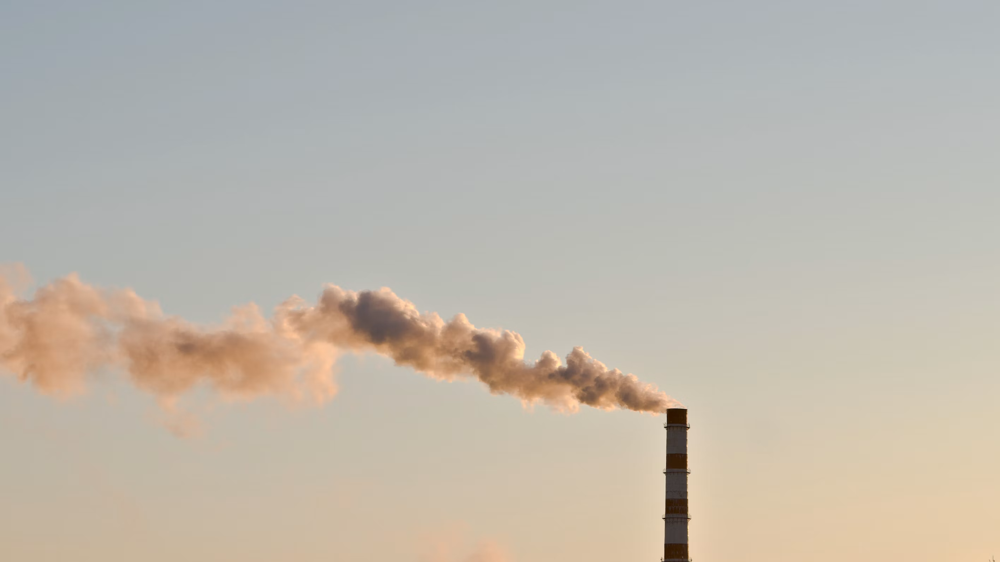

::: {.home-band .home-hero}

::: {.home-hero-text}
## Welcome to Tracking Climate Impacts!

TrackingClimateImpacts.us is an open, reproducible collection of climate change impact indicators for the United States. Built entirely from public data--with code and sources published alongside them—these indicators track observed trends in climate-related metrics that matter to people, public health, and the environment. They offer clear, trustworthy information to support evidence-based action and help state, local and public health practitioners plan for climate impacts, while ensuring students, researchers and the public have access to critical data.
:::

::: {.home-hero-img}
{fig-alt=""}
:::

:::

::: {.home-band .home-mission}
Our mission, at GW’s Climate and Health Institute, is to maintain and expand these climate change impact indicators as a durable and transparent resource and to strengthen collaboration among data providers, developers, and users across academia and state, local, and community practitioners.
:::

::: {.home-band}

::: {.home-feature .indicators}

::: {.home-feature-text}
::: {.home-feature-eyebrow}
The Indicators
:::

## Health & Environment Indicators

Rising temperatures, shifting snow and rainfall patterns, and more frequent extreme weather events are clear signs of a changing climate. Many of these observed changes are linked to increasing greenhouse gas concentrations in the atmosphere caused by human activities. The indicators presented here document these changes and help illustrate impacts that matter to human health, communities, ecosystems, and the environment.

[View Data ↗](indicators.qmd){.home-feature-link}
:::

::: {.home-feature-img}
{fig-alt=""}
:::

:::

::: {.home-feature .story}

::: {.home-feature-text}
## Emissions & Climate Resources

Climate indicators illuminate the full arc of climate change—from trends in the greenhouse gas emissions that drive planetary warming, to shifts in Earth’s systems, to the impacts felt in communities and ecosystems. While TrackingClimateImpacts.us provides a range of indicators and focuses on the impacts of climate change in the United States, understanding those impacts requires seeing them within the broader context of global change.

[Understand the context ↗](emissions-and-climate-resources.qmd){.home-feature-link}
:::

::: {.home-feature-img}
{fig-alt=""}
:::

:::

:::

::: {.home-band .home-section .first}
## Methodology

This section documents the transparent, reproducible processes that underpin the indicators on TrackingClimateImpacts.us and preserves the methodological foundation developed by the U.S. Environmental Protection Agency (EPA) through January 2025. It also describes how our approach will evolve as new science, data, and partnerships emerge.

[Learn More](methodology.qmd){.home-btn}
:::

::: {.home-band .home-section}
## Where We’re Heading

GW’s Climate & Health Institute is preserving EPA’s climate change indicators and setting the stage for a durable, impact-focused, and community-connected system for use by practitioners, policy developers and the public.

[Learn More](where-were-heading.qmd){.home-btn}
:::

::: {.home-band .home-section}
## About

Learn about who we are and our approach.

[Learn More](about.qmd){.home-btn}
:::


