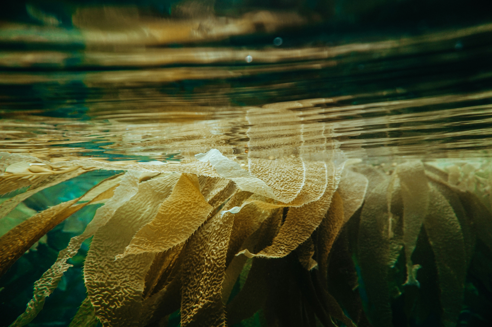

## Coastal and Marine

This indicator tracks marine heat waves, sea levels, coastal flooding, ocean acidity, and land loss along the Atlantic coastline.

Category

- [Weather and Extreme Events](../../indicators/weather-and-extreme-events/weather-and-extreme-events.llms.md)
- [Snow and Ice](../../indicators/snow-and-ice/snow-and-ice.llms.md)
- [Coastal and Marine](../../indicators/coastal-and-marine/coastal-and-marine.llms.md)
- [Freshwater Systems](../../indicators/freshwater-systems/freshwater-systems.llms.md)
- [Ecosystems](../../indicators/ecosystems/ecosystems.llms.md)
- [Temperature-Related Health](../../indicators/temperature-related-health/temperature-related-health.llms.md)
- [Vector-Related Health](../../indicators/vector-related-health/vector-related-health.llms.md)
- [Societal Systems](../../indicators/societal-systems/societal-systems.llms.md)

##### Sea Surface Temperature

This indicator describes global trends in sea surface temperature.

##### Sea Level

This indicator describes how sea level has changed over time. The indicator describes two types of sea level changes: absolute and relative.

##### Coastal Flooding

This indicator shows how the frequency of coastal flooding has changed over time.

##### Marine Heat Waves

This indicator tracks the occurrence of unusually high temperatures in U.S. coastal waters.

##### A Closer Look: Land Loss Along the Atlantic Coast

This feature provides a closer look at one consequence of sea level rise along the Atlantic coast: the conversion of land to open water.

##### Antarctic Sea Ice

This indicator tracks the extent of sea ice around Antarctica.

##### Ocean Acidity

This indicator describes changes in the chemistry of the ocean that relate to the amount of carbon dioxide dissolved in the water.

[View All](../../health-and-environment-indicators.llms.md)

**GW Climate and Health Institute**

950 New Hampshire Ave, NW, 101 — First Floor\
Washington, DC 20052

### About

- [About](../../about.llms.md)
- [Where We’re Heading](../../where-were-heading.llms.md)

### Emissions & Climate Resources

- [Emissions & Climate Resources](../../emissions-and-climate-resources.llms.md)
- [Green House Gases](../../greenhouse-gases.llms.md)
- [Global Climate Indicators](../../global-climate-indicators.llms.md)
- [Additional Resources](../../additional-resources.llms.md)

### The Indicators

- [Weather and Extreme Events](../../indicators/weather-and-extreme-events/weather-and-extreme-events.llms.md)
- [Snow and Ice](../../indicators/snow-and-ice/snow-and-ice.llms.md)
- [Coastal and Marine](../../indicators/coastal-and-marine/coastal-and-marine.llms.md)
- [Freshwater Systems](../../indicators/freshwater-systems/freshwater-systems.llms.md)
- [Ecosystems](../../indicators/ecosystems/ecosystems.llms.md)
- [Temperature-Related Health](../../indicators/temperature-related-health/temperature-related-health.llms.md)
- [Vector-Related Health](../../indicators/vector-related-health/vector-related-health.llms.md)
- [Societal Systems](../../indicators/societal-systems/societal-systems.llms.md)

### GW

- [Campus Advisories](https://campusadvisories.gwu.edu/)
- [EO/Nondiscrimination Policy](https://compliance.gwu.edu/equal-opportunity-nondiscrimination-anti-harassment-and-non-retaliation)
- [Website Privacy Notice](https://www.gwu.edu/privacy-notice)
- [Contact GW](https://www.gwu.edu/contact-gw)
- [Accessibility](https://accessibility.gwu.edu/)
- [Terms of Use](https://www.gwu.edu/terms-use)
- [Copyright](https://www.gwu.edu/copyright)
- [Report a Barrier to Accessibility](https://accessibility.gwu.edu/report-barrier-accessibility)

- Terms of Service
- Privacy Policy
- Contact Us

Back to top
