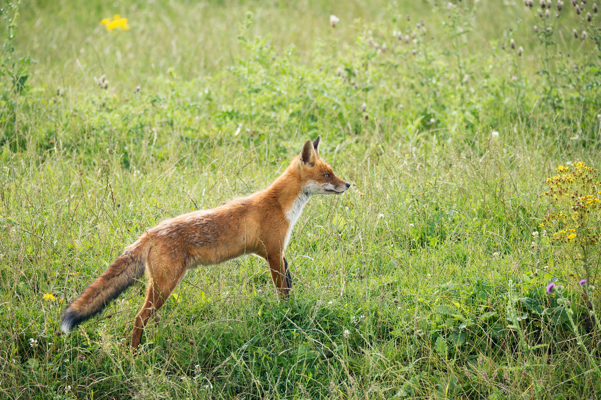

## Ecosystems

These indicators track changes in the length of the growing season, growing degree days, ragweed pollen season, leaf and bloom dates, marine species distribution, and bird wintering ranges.

Category

- [Weather and Extreme Events](../../indicators/weather-and-extreme-events/weather-and-extreme-events.llms.md)
- [Snow and Ice](../../indicators/snow-and-ice/snow-and-ice.llms.md)
- [Coastal and Marine](../../indicators/coastal-and-marine/coastal-and-marine.llms.md)
- [Freshwater Systems](../../indicators/freshwater-systems/freshwater-systems.llms.md)
- [Ecosystems](../../indicators/ecosystems/ecosystems.llms.md)
- [Temperature-Related Health](../../indicators/temperature-related-health/temperature-related-health.llms.md)
- [Vector-Related Health](../../indicators/vector-related-health/vector-related-health.llms.md)
- [Societal Systems](../../indicators/societal-systems/societal-systems.llms.md)

##### Length of Growing Season

How the length of the growing season, and the timing of spring and fall frosts, has changed across the contiguous 48 states since 1895.

##### Growing Degree Days

How growing degree days have changed at 280 long-term weather stations across the contiguous 48 states since 1948, and what that suggests about pollen seasons.

##### Ragweed Pollen Season

How the length of ragweed pollen season has changed at 11 locations across the central United States and Canada since 1995.

##### Leaf and Bloom Dates

How the timing of first leaf and first bloom dates in lilacs and honeysuckles has changed across the contiguous 48 states and Alaska.

##### Community Connection: Cherry Blossom Bloom Dates in Washington, D.C.

How the peak bloom date of Washington, D.C.’s Yoshino cherry trees has changed since 1921, alongside the dates of the National Cherry Blossom Festival.

##### Marine Species Distribution

This indicator examines changes in the location of fish, shellfish, and other marine species along U.S. coasts.

##### Bird Wintering Ranges

This indicator examines changes in the winter ranges of North American birds.

##### A Closer Look: The Black Guillemots of Cooper Island

This feature explores changes in bird populations on an island along Alaska’s Arctic northern coast.

[View All](../../health-and-environment-indicators.llms.md)

**GW Climate and Health Institute**

950 New Hampshire Ave, NW, 101 — First Floor\
Washington, DC 20052

### About

- [About](../../about.llms.md)
- [Where We’re Heading](../../where-were-heading.llms.md)

### Emissions & Climate Resources

- [Emissions & Climate Resources](../../emissions-and-climate-resources.llms.md)
- [Green House Gases](../../greenhouse-gases.llms.md)
- [Global Climate Indicators](../../global-climate-indicators.llms.md)
- [Additional Resources](../../additional-resources.llms.md)

### The Indicators

- [Weather and Extreme Events](../../indicators/weather-and-extreme-events/weather-and-extreme-events.llms.md)
- [Snow and Ice](../../indicators/snow-and-ice/snow-and-ice.llms.md)
- [Coastal and Marine](../../indicators/coastal-and-marine/coastal-and-marine.llms.md)
- [Freshwater Systems](../../indicators/freshwater-systems/freshwater-systems.llms.md)
- [Ecosystems](../../indicators/ecosystems/ecosystems.llms.md)
- [Temperature-Related Health](../../indicators/temperature-related-health/temperature-related-health.llms.md)
- [Vector-Related Health](../../indicators/vector-related-health/vector-related-health.llms.md)
- [Societal Systems](../../indicators/societal-systems/societal-systems.llms.md)

### GW

- [Campus Advisories](https://campusadvisories.gwu.edu/)
- [EO/Nondiscrimination Policy](https://compliance.gwu.edu/equal-opportunity-nondiscrimination-anti-harassment-and-non-retaliation)
- [Website Privacy Notice](https://www.gwu.edu/privacy-notice)
- [Contact GW](https://www.gwu.edu/contact-gw)
- [Accessibility](https://accessibility.gwu.edu/)
- [Terms of Use](https://www.gwu.edu/terms-use)
- [Copyright](https://www.gwu.edu/copyright)
- [Report a Barrier to Accessibility](https://accessibility.gwu.edu/report-barrier-accessibility)

- Terms of Service
- Privacy Policy
- Contact Us

Back to top
