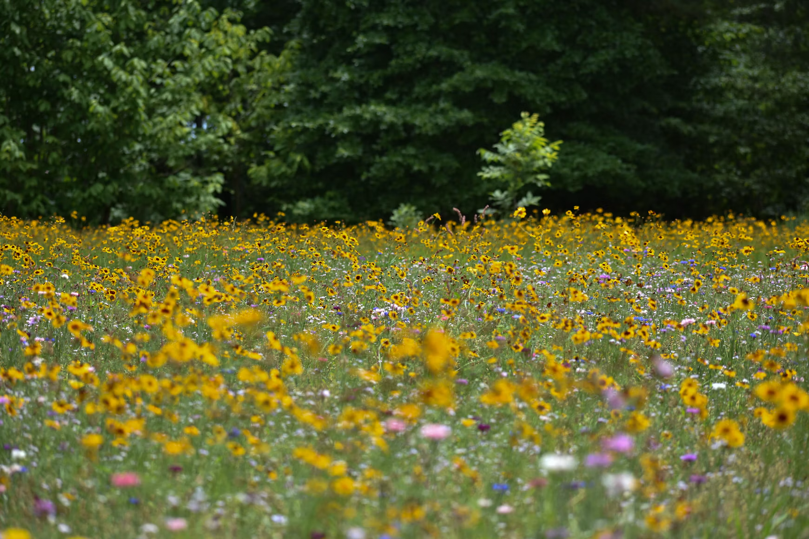

::: {.home-band .cat-hero .cat-ecosystems .hero-bg}

::: {.hero-bg-img}
{fig-alt=""}
:::

## Ecosystems
:::

::: {.home-band .cat-body}
<!-- DRAFT intro built from the indicator names; replace with the Figma wording. -->
::: {.cat-intro}
These indicators track changes in the length of the growing season, growing degree days, ragweed pollen season, leaf and bloom dates, marine species distribution, and bird wintering ranges.
:::

::: {.cat-columns}


::: {.cat-main}
::: {#cat-listing}
:::

[Back to Categories](/health-and-environment-indicators.qmd){.cat-viewall}
:::
:::
:::


