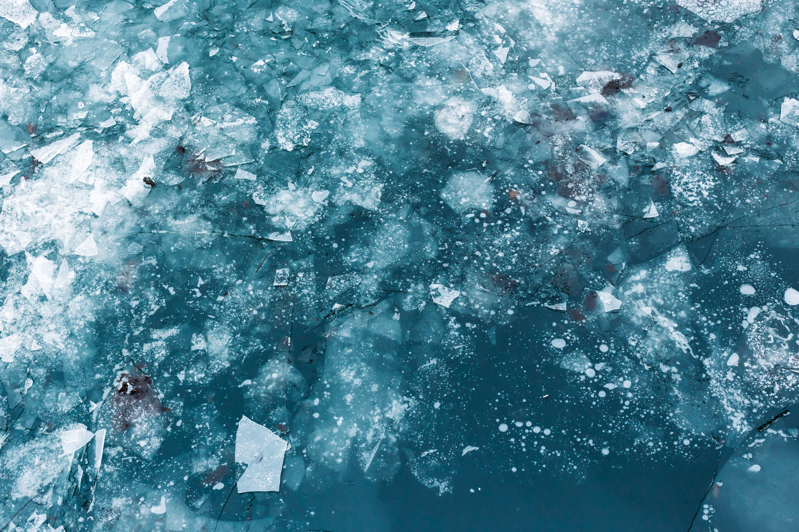

## Snow and Ice

This indicator tracks changes in lake ice, Great Lakes ice cover, snowfall, snow cover, snowpack, permafrost, freeze-thaw conditions, glaciers, and river ice breakup.

Category

- [Weather and Extreme Events](../../indicators/weather-and-extreme-events/index.llms.md)
- [Snow and Ice](../../indicators/snow-and-ice/index.llms.md)
- [Coastal and Marine](../../indicators/coastal-and-marine/index.llms.md)
- [Freshwater Systems](../../indicators/freshwater-systems/index.llms.md)
- [Ecosystems](../../indicators/ecosystems/index.llms.md)
- [Temperature-Related Health](../../indicators/temperature-related-health/index.llms.md)
- [Vector-Related Health](../../indicators/vector-related-health/index.llms.md)
- [Societal Systems](../../indicators/societal-systems/index.llms.md)

##### A Closer Look: Glaciers in Glacier National Park

This regional feature examines how the surface area of glaciers in Glacier National Park in Montana has changed since 1966.

##### Lake Ice

This indicator measures the amount of time that ice is present on lakes in the United States.

##### Great Lakes Ice Cover

This indicator measures the area and duration of ice cover in the Great Lakes.

##### Snowfall

This indicator uses two different measures to show how snowfall has changed in the contiguous 48 states.

##### Snowpack

This indicator measures trends in the amount and timing of snowpack in the western United States.

##### Permafrost

This indicator shows trends in permafrost temperature at select sites in Alaska.

##### Freeze-Thaw Conditions

This indicator tracks the number of days the U.S. and North American landscape is not frozen.

##### Ice Sheets

This indicator examines the balance between snow accumulation and melting in the ice sheets that cover Greenland and Antarctica.

##### Community Connection: Ice Breakup in Three Alaskan Rivers

This feature examines the timing of spring river ice breakup in three communities that have kept detailed records for more than 100 years.

[Back to Categories](../../health-and-environment-indicators.llms.md)

**GW Climate and Health Institute**

950 New Hampshire Ave, NW, 101 — First Floor\
Washington, DC 20052

### About

- [About](../../about.llms.md)
- [Where We’re Heading](../../where-were-heading.llms.md)

### Emissions & Climate Resources

- [Emissions & Climate Resources](../../emissions-and-climate-resources.llms.md)
- [Greenhouse Gases](../../greenhouse-gases.llms.md)
- [Global Climate Indicators](../../global-climate-indicators.llms.md)
- [Additional Resources](../../additional-resources.llms.md)

### The Indicators

- [Weather and Extreme Events](../../indicators/weather-and-extreme-events/index.llms.md)
- [Snow and Ice](../../indicators/snow-and-ice/index.llms.md)
- [Coastal and Marine](../../indicators/coastal-and-marine/index.llms.md)
- [Freshwater Systems](../../indicators/freshwater-systems/index.llms.md)
- [Ecosystems](../../indicators/ecosystems/index.llms.md)
- [Temperature-Related Health](../../indicators/temperature-related-health/index.llms.md)
- [Vector-Related Health](../../indicators/vector-related-health/index.llms.md)
- [Societal Systems](../../indicators/societal-systems/index.llms.md)

### GW

- [Campus Advisories](https://campusadvisories.gwu.edu/)
- [EO/Nondiscrimination Policy](https://compliance.gwu.edu/equal-opportunity-nondiscrimination-anti-harassment-and-non-retaliation)
- [Website Privacy Notice](https://www.gwu.edu/privacy-notice)
- [Contact GW](https://www.gwu.edu/contact-gw)
- [Accessibility](https://accessibility.gwu.edu/)
- [Terms of Use](https://www.gwu.edu/terms-use)
- [Copyright](https://www.gwu.edu/copyright)
- [Report a Barrier to Accessibility](https://accessibility.gwu.edu/report-barrier-accessibility)

- Terms of Service
- Privacy Policy
- [Contact Us](mailto:climatehealth@gwu.edu)

Back to top
