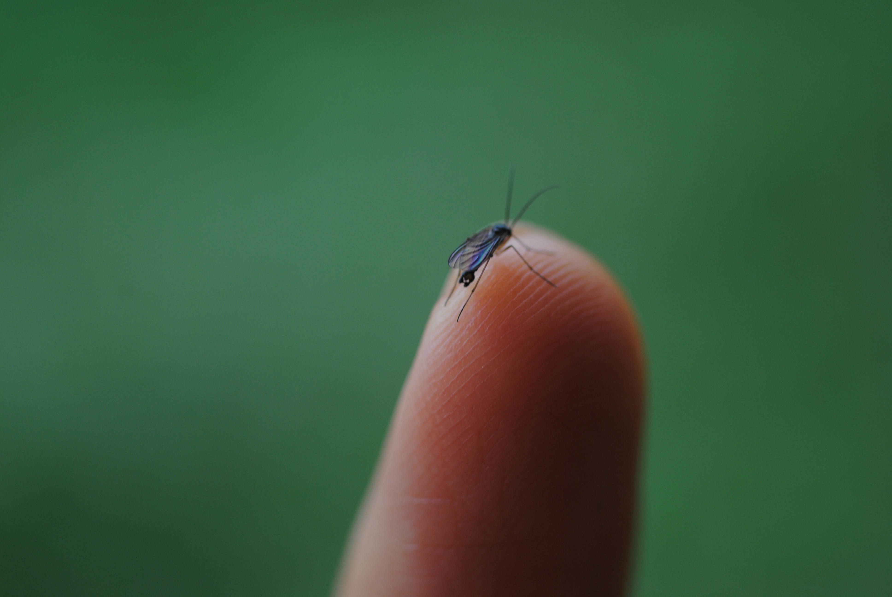

## Vector-Related Health

These indicators track changes in the occurrence of Lyme disease and West Nile virus.

Category

- [Weather and Extreme Events](../../indicators/weather-and-extreme-events/index.llms.md)
- [Snow and Ice](../../indicators/snow-and-ice/index.llms.md)
- [Coastal and Marine](../../indicators/coastal-and-marine/index.llms.md)
- [Freshwater Systems](../../indicators/freshwater-systems/index.llms.md)
- [Ecosystems](../../indicators/ecosystems/index.llms.md)
- [Temperature-Related Health](../../indicators/temperature-related-health/index.llms.md)
- [Vector-Related Health](../../indicators/vector-related-health/index.llms.md)
- [Societal Systems](../../indicators/societal-systems/index.llms.md)

##### Lyme Disease

This indicator tracks the rate of reported Lyme disease cases across the United States.

##### West Nile Virus

This indicator tracks the rate of reported West Nile neuroinvasive disease cases across the United States.

This is an active area of research and data development in the climate and health arena. This category of indicators is likely to expand as the science advances. Stay tuned!

[Back to Categories](../../health-and-environment-indicators.llms.md)

**GW Climate and Health Institute**

950 New Hampshire Ave, NW, 101 — First Floor\
Washington, DC 20052

### About

- [About](../../about.llms.md)
- [Where We’re Heading](../../where-were-heading.llms.md)

### Emissions & Climate Resources

- [Emissions & Climate Resources](../../emissions-and-climate-resources.llms.md)
- [Greenhouse Gases](../../greenhouse-gases.llms.md)
- [Global Climate Indicators](../../global-climate-indicators.llms.md)
- [Additional Resources](../../additional-resources.llms.md)

### The Indicators

- [Weather and Extreme Events](../../indicators/weather-and-extreme-events/index.llms.md)
- [Snow and Ice](../../indicators/snow-and-ice/index.llms.md)
- [Coastal and Marine](../../indicators/coastal-and-marine/index.llms.md)
- [Freshwater Systems](../../indicators/freshwater-systems/index.llms.md)
- [Ecosystems](../../indicators/ecosystems/index.llms.md)
- [Temperature-Related Health](../../indicators/temperature-related-health/index.llms.md)
- [Vector-Related Health](../../indicators/vector-related-health/index.llms.md)
- [Societal Systems](../../indicators/societal-systems/index.llms.md)

### GW

- [Campus Advisories](https://campusadvisories.gwu.edu/)
- [EO/Nondiscrimination Policy](https://compliance.gwu.edu/equal-opportunity-nondiscrimination-anti-harassment-and-non-retaliation)
- [Website Privacy Notice](https://www.gwu.edu/privacy-notice)
- [Contact GW](https://www.gwu.edu/contact-gw)
- [Accessibility](https://accessibility.gwu.edu/)
- [Terms of Use](https://www.gwu.edu/terms-use)
- [Copyright](https://www.gwu.edu/copyright)
- [Report a Barrier to Accessibility](https://accessibility.gwu.edu/report-barrier-accessibility)

- Terms of Service
- Privacy Policy
- [Contact Us](mailto:climatehealth@gwu.edu)

Back to top
