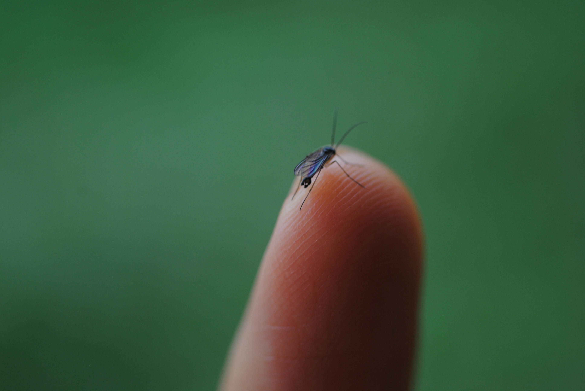

::: {.home-band .cat-hero .cat-vector-health .hero-bg}

::: {.hero-bg-img}
{fig-alt=""}
:::

## Vector-Related Health
:::

::: {.home-band .cat-body}
<!-- DRAFT intro built from the indicator names; replace with the Figma wording. -->
::: {.cat-intro}
These indicators track changes in the occurrence of Lyme disease and West Nile virus.
:::

::: {.cat-columns}


::: {.cat-main}
::: {#cat-listing}
:::

[View All](/health-and-environment-indicators.qmd){.cat-viewall}
:::
:::
:::


