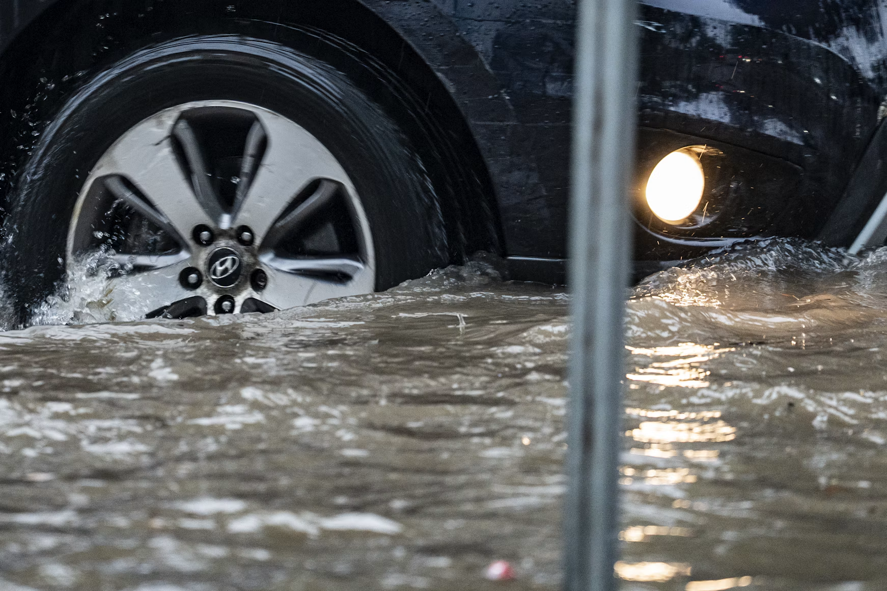

## Weather and Extreme Events

This indicator tracks changes in national and global temperatures, precipitation, and extreme weather events, including heat waves, wildfires, tropical cyclones, flooding, and drought.

Category

- [Weather and Extreme Events](../../indicators/weather-and-extreme-events/index.llms.md)
- [Snow and Ice](../../indicators/snow-and-ice/index.llms.md)
- [Coastal and Marine](../../indicators/coastal-and-marine/index.llms.md)
- [Freshwater Systems](../../indicators/freshwater-systems/index.llms.md)
- [Ecosystems](../../indicators/ecosystems/index.llms.md)
- [Temperature-Related Health](../../indicators/temperature-related-health/index.llms.md)
- [Vector-Related Health](../../indicators/vector-related-health/index.llms.md)
- [Societal Systems](../../indicators/societal-systems/index.llms.md)

##### U.S. and Global Temperature

How average air temperature has changed across the contiguous United States and worldwide since 1901, and how those changes vary by climate division.

##### Seasonal Temperature

Trends in average seasonal air temperature across the contiguous United States since 1896, and how the change varies by season and by state.

##### High and Low Temperatures

Trends in unusually hot and cold temperatures across the United States.

##### Heat Waves

Trends in the frequency, duration, season length, and intensity of heat waves in 50 large U.S. cities since 1961, and in the U.S. Annual Heat Wave Index since 1895.

##### Heavy Precipitation

This indicator tracks the frequency of heavy precipitation events in the United States.

##### Tropical Cyclone Activity

Frequency, intensity, and duration of hurricanes and other tropical storms in the Atlantic Ocean, Caribbean, and Gulf of Mexico.

##### River Flooding

How the magnitude and frequency of river flooding have changed at stream gauge stations across the United States since 1965.

##### Drought

This indicator measures drought conditions of U.S. lands.

##### A Closer Look: Temperature and Drought in the Southwest

A closer look at trends in temperature and drought in the southwestern United States.

##### Wildfires

This indicator tracks the frequency, extent, and severity of wildfires in the United States.

[Back to Categories](../../health-and-environment-indicators.llms.md)

**GW Climate and Health Institute**

950 New Hampshire Ave, NW, 101 — First Floor\
Washington, DC 20052

### About

- [About](../../about.llms.md)
- [Where We’re Heading](../../where-were-heading.llms.md)

### Emissions & Climate Resources

- [Emissions & Climate Resources](../../emissions-and-climate-resources.llms.md)
- [Greenhouse Gases](../../greenhouse-gases.llms.md)
- [Global Climate Indicators](../../global-climate-indicators.llms.md)
- [Additional Resources](../../additional-resources.llms.md)

### The Indicators

- [Weather and Extreme Events](../../indicators/weather-and-extreme-events/index.llms.md)
- [Snow and Ice](../../indicators/snow-and-ice/index.llms.md)
- [Coastal and Marine](../../indicators/coastal-and-marine/index.llms.md)
- [Freshwater Systems](../../indicators/freshwater-systems/index.llms.md)
- [Ecosystems](../../indicators/ecosystems/index.llms.md)
- [Temperature-Related Health](../../indicators/temperature-related-health/index.llms.md)
- [Vector-Related Health](../../indicators/vector-related-health/index.llms.md)
- [Societal Systems](../../indicators/societal-systems/index.llms.md)

### GW

- [Campus Advisories](https://campusadvisories.gwu.edu/)
- [EO/Nondiscrimination Policy](https://compliance.gwu.edu/equal-opportunity-nondiscrimination-anti-harassment-and-non-retaliation)
- [Website Privacy Notice](https://www.gwu.edu/privacy-notice)
- [Contact GW](https://www.gwu.edu/contact-gw)
- [Accessibility](https://accessibility.gwu.edu/)
- [Terms of Use](https://www.gwu.edu/terms-use)
- [Copyright](https://www.gwu.edu/copyright)
- [Report a Barrier to Accessibility](https://accessibility.gwu.edu/report-barrier-accessibility)

- Terms of Service
- Privacy Policy
- [Contact Us](mailto:climatehealth@gwu.edu)

Back to top
