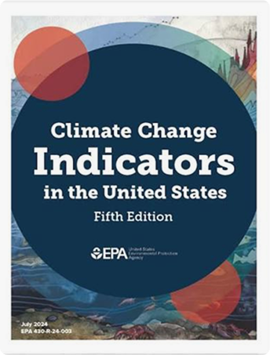

::: {.home-band .method-hero .hero-split}

::: {.hero-split-text}
## Methodology

This section documents the transparent, reproducible processes that underpin the indicators on TrackingClimateImpacts.us and preserves the methodological foundation developed by the U.S. Environmental Protection Agency (EPA) through January 2025. It also describes how our approach will evolve as new science, data, and partnerships emerge.

:::

::: {.hero-split-img}
{fig-alt=""}
:::

:::

::: {.home-band .method-process}
## EPA’s Indicator Development Process (through January 2025)

EPA developed climate indicators using a rigorous, multi‑step workflow designed to ensure scientific integrity, transparency, and usefulness for public audiences. Each indicator included detailed technical documentation, while EPA’s methodology page provided overarching guidance on how indicators were identified, evaluated, developed, and reviewed.

**EPA’s process included the following steps (for more detail, click on a box):**

::: {.method-steps}
::: {.method-step tabindex="0"}
[01]{.method-step-num} Identification

::: {.method-step-card}
[Identification]{.method-step-card-title}

**EPA considered potential indicators based on whether they:**

- Filled gaps in the existing indicator set
- Reflected newly available data from academic, government, or other sources
- Built on internal or external indicator development efforts
- Offered strong communication value for public audiences
:::
:::
::: {.method-step tabindex="0"}
[02]{.method-step-num} Evaluation

::: {.method-step-card}
[Evaluation]{.method-step-card-title}

**Candidate indicators were assessed against ten criteria:**

- Trends over time
- Actual observations
- Broad geographic coverage
- Peer‑reviewed data
- Uncertainty
- Usefulness
- Connection to climate change
- Transparency, reproducibility, and objectivity
- Public understandability
- Feasibility to construct
:::
:::
::: {.method-step tabindex="0"}
[03]{.method-step-num} Screening

::: {.method-step-card}
[Screening]{.method-step-card-title}

EPA screened indicators using Tier 1 criteria: peer‑review status, feasibility, usefulness, public understandability, connection to climate change. Indicators that did not meet these criteria were excluded, though some could become viable in the future as data availability improves.

Indicators meeting Tier 1 criteria were then evaluated using Tier 2 criteria: transparency, reproducibility, objectivity, geographic range, observational basis, trends over time, and uncertainty.
:::
:::
::: {.method-step tabindex="0"}
[04]{.method-step-num} Development

::: {.method-step-card}
[Development]{.method-step-card-title}

Promising indicators were developed into proposed summaries based on published literature, expert consultation, and online databases. Draft summaries included graphics, summary tables, data sources, limitations, and other relevant information. After internal review, selected indicators were fully developed.
:::
:::
::: {.method-step tabindex="0"}
[05]{.method-step-num} Review

::: {.method-step-card}
[Review]{.method-step-card-title}

**Complete indicator packages underwent:**

- EPA internal review
- Review by data providers and collaborators
- Independent peer review by external subject‑matter experts
:::
:::
::: {.method-step tabindex="0"}
[06]{.method-step-num} Revision

::: {.method-step-card}
[Revision]{.method-step-card-title}

Existing indicators were periodically re‑evaluated as new data and scientific understanding became available.

[Technical Documentation: Climate Change Indicators in the United States, Fifth Edition (EPA, 2024)](https://19january2025snapshot.epa.gov/system/files/documents/2024-07/technical_documentation_2024.pdf)
:::
:::
:::
:::

::: {.home-band .method-doc-wrap}
::: {.method-doc}

::: {.method-doc-text}
[Technical Document]{.method-doc-title}

U.S. Environmental Protection Agency. (2024). Climate change indicators in the United States (Fifth ed., EPA 430-R-24-003)

[Read Here](https://19january2025snapshot.epa.gov/climate-indicators/view-indicators/index.html){.method-doc-btn}
:::

::: {.method-doc-img}
{fig-alt="Cover of EPA's Climate Change Indicators in the United States, Fifth Edition"}
:::

:::
:::

::: {.home-band .method-next}
## Our Approach Moving Forward

TrackingClimateImpacts.us maintains the full technical documentation and methodological detail from EPA’s January 19, 2025 snapshot to ensure continuity, transparency, and trust. As the project advances, we plan to:
:::

::: {.home-band .method-plan}
[As the project advances, we plan to:]{.method-plan-title}

::: {.method-plan-item}
[01]{.method-plan-num} Preserve and update the technical documentation for all replicated indicators.
:::
::: {.method-plan-item}
[02]{.method-plan-num} Develop new documentation for emerging indicators, especially those focused on climate and health.
:::
::: {.method-plan-item}
[03]{.method-plan-num} Maintain an open technical repository with code, data sources, and reproducible workflows for transparency.
:::
::: {.method-plan-item}
[04]{.method-plan-num} Collaborate with data providers, researchers, and communities to refine methods and ensure indicators reflect real‑world needs.
:::
::: {.method-plan-item}
[05]{.method-plan-num} Ensure technical review and credibility.
:::
:::


